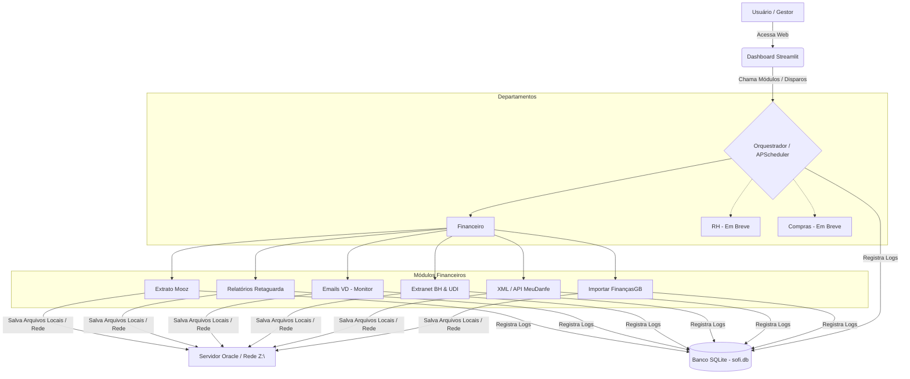

# SOFI-core — Sistema Operacional Financeiro Integrado

> **Auxiliar Corporativo Autônomo** — Centraliza, automatiza, concilia e gerencia fluxos operacionais e financeiros multi-departamentais (UDI e BH) de forma autônoma e sem necessidade de intervenção humana constante.


---

## 📌 Índice

- [Objetivo do Projeto](#-objetivo-do-projeto)
- [Arquitetura do Sistema](#-arquitetura-do-sistema)
- [Estrutura do Repositório](#-estrutura-do-repositório)
- [Departamentos e Módulos](#-departamentos-e-módulos)
- [Estrutura de Dados e Logs](#-estrutura-de-dados-e-logs)
- [Dependências e Bibliotecas](#-dependências-e-bibliotecas)
- [Configuração de Ambiente](#-configuração-de-ambiente)
- [Como Rodar](#-como-rodar)
- [Deploy em Servidor (Produção)](#-deploy-em-servidor-produção)
- [Manutenção e Resolução de Problemas](#-manutenção-e-resolução-de-problemas)
- [Diretrizes de Governança e Contribuição](#-diretrizes-de-governança-e-contribuição)

---

## 🎯 Objetivo do Projeto

O **SOFI** foi idealizado para sanar e automatizar o gargalo de tarefas repetitivas e manuais do setor financeiro de uma empresa franqueada do **Grupo Boticário**, que atende a **43 lojas** divididas entre as regiões de **Uberlândia (UDI)** e **Belo Horizonte (BH)**. 

O que começou como automações isoladas evoluiu para um **Hub Corporativo Centralizado**. O sistema atua como um **ativo estratégico permanente da empresa**, totalmente documentado, versionado no Git e livre de qualquer dependência pessoal para a execução ou manutenção do fluxo de negócios.

### Principais Resultados Obtidos
* **Redução de tempo operacional:** De 2h a 3h diárias para apenas **5 minutos**.
* **Eficiência do Assistente Financeiro:** Mais de **80%** das atividades repetitivas foram automatizadas.
* **Processamento de E-mails de Venda Direta (VD):** Importação concluída em apenas **2 minutos** automaticamente.
* **Escalabilidade:** Geração e processamento automático do extrato de **42 lojas**.

---

## 🏗️ Arquitetura do Sistema

O sistema é desenhado de forma desacoplada: a interface visual (dashboard) atua estritamente como visualizadora e disparadora, enquanto os scripts reais processam a lógica de negócios em background, registrando todo o ciclo de vida no banco de dados SQLite.



---

## 📂 Estrutura do Repositório

```text
sofi-core/
│
├── core/                          # Utilitários compartilhados do núcleo
│   ├── database/
│   │   └── sofi.db                # Banco SQLite de logs e histórico
│   ├── scheduler/
│   │   ├── __init__.py
│   │   ├── scheduler.py           # Orquestrador central de jobs
│   │   └── scheduler_config.json  # Configurações de horários dos cronjobs
│   ├── logger.py                  # Decorator de captura de saídas e gravação no DB
│   └── sofi_env.py                # Carregador inteligente do .env raiz e .env.local
│
├── dashboard/                     # Interface Web (Streamlit Hub)
│   ├── app.py                     # Portal de Entrada
│   ├── style.css                  # Folha de estilo visual (Padrão Sage)
│   ├── components/
│   │   └── layout.py              # Cabeçalho, rodapé e navbar estilo Sage
│   └── pages/
│       ├── financeiro.py          # Dashboard do Financeiro
│       ├── extranet.py            # Execução manual e console da Extranet
│       ├── retaguarda.py          # Execução manual e console da Retaguarda
│       ├── xml.py                 # Gerenciamento de Notas e relatórios Cálamo
│       ├── rh.py                  # Dashboard do RH (Placeholder)
│       └── compras.py             # Dashboard de Compras (Placeholder)
│
├── departments/                   # Código dos Departamentos
│   ├── financeiro/
│   │   ├── README.md              # Documentação das automações financeiras
│   │   ├── .env.local             # Variáveis de ambiente exclusivas do Financeiro
│   │   └── modules/               # Scripts e automações de robôs
│   │       ├── extratos/          # Integração Mooz Cartões
│   │       ├── relatorios/        # Relatórios Retaguarda/Financeiro
│   │       ├── depositos/         # Lançamento e conferência de depósitos via API
│   │       ├── emails_vd/         # Monitor automático de caixas do Outlook
│   │       ├── extranet/          # Robôs Playwright de vendas extranet (BH/UDI)
│   │       ├── xml/               # Leitor e gerador de planilha de notas fiscais
│   │       └── importar_financas.py # Script de upload no FinançasGB (Playwright)
│   │
│   ├── rh/
│   │   ├── README.md
│   │   └── modules/               # Futura triagem automatizada com IA
│   │
│   └── compras/
│       ├── README.md
│       └── modules/               # Mapeamentos e cálculos de compras
│
├── docs/                          # Documentações antigas e complementares
├── MDS/                           # Documentos conceituais e planos de ação
├── .env                           # Credenciais compartilhadas globais (NÃO versionado)
├── .env.example                   # Template global de credenciais
├── .gitignore                     # Filtro de arquivos para o Git
└── LICENSE                        # Licença do projeto
```

---

## 💼 Departamentos e Módulos

### 1. Departamento Financeiro

| Módulo | Tipo / Script | Portais Integrados | Status | Descrição |
| :--- | :--- | :--- | :--- | :--- |
| **SOFI Extrato** | Automação Mooz | Mooz Cartões | ✅ Ativo | Coleta os extratos de cartões de 21 lojas. |
| **SOFI Relatórios** | Extrator Retaguarda | Retaguarda / FinançasGB | ✅ Ativo | Extrai relatórios de faturamento diário. |
| **SOFI Emails VD** | `monitor_emails_vd.py` | Outlook Desktop (COM) | ✅ Ativo | Monitora em background novas caixas de e-mail de Venda Direta (3 UDI + 3 BH), extrai os anexos XLSX, converte para XLS (compatível com o Oracle) e salva na Rede Z:\. |
| **SOFI Extranet** | `extranet_reports_udi/bh.py` | Extranet Boticário | ✅ Ativo | Acessa a extranet com Playwright, baixa o CSV de vendas diárias D-1 e chama o importador de finanças. |
| **SOFI XML** | `debug_meudanfe.py` | API MeuDanfe v2 | ✅ Ativo | Busca chaves de acesso NFe nas planilhas, envia e baixa XMLs da SEFAZ via API MeuDanfe, gerando a planilha de auditoria Cálamo. |
| **SOFI Importa** | `importar_financas.py` | FinançasGB | ✅ Ativo | Utilitário comum via Playwright que realiza login no portal e faz o upload automático dos arquivos extraídos para a nuvem. |
| **SOFI Depósitos** | `script_depositos.py` | FinançasGB API | 🔄 Em Evolução | Automação e lançamento de depósitos identificados por API. |
| **SOFI Concilia** | Motor Financeiro | Interno | 🔄 Em Evolução | Motor interno de cruzamento de dados bancários e vendas. |

### 2. Recursos Humanos (RH)
* **Triagem de Currículos:** Sistema que utilizará IA para processar currículos recebidos em massa e classificá-los para vagas abertas. *(Status: 🕐 Em Breve)*

### 3. Compras
* **Mapeador de Insumos:** Consolidação automática de tabelas de custos de compras corporativas. *(Status: 🕐 Em Breve)*

---

## 🗄️ Estrutura de Dados e Logs

Toda a governança de execuções do sistema é mantida de forma centralizada em um banco de dados local **SQLite**.

### 1. Banco de Dados SQLite (`core/database/sofi.db`)
Tabela principal: `execution_logs`
```sql
CREATE TABLE IF NOT EXISTS execution_logs (
    id INTEGER PRIMARY KEY AUTOINCREMENT,
    modulo TEXT,                             -- Nome do script ou módulo
    status TEXT,                             -- INICIADO, SUCESSO, ERRO, INFO, AVISO
    mensagem TEXT,                           -- Saída de texto do terminal/exceções
    timestamp DATETIME DEFAULT CURRENT_TIMESTAMP,
    usuario TEXT                             -- Usuário do sistema operacional
);
```

### 2. Captura de Logs Dinâmica (`core/database/logger.py`)
Qualquer script em Python do projeto pode ser envelopado pelo decorator `@log_execution(modulo="NomeDoModulo")`. Esse decorator realiza as seguintes tarefas automaticamente:
1. Registra um registro inicial com status `INICIADO`.
2. Intercepta as saídas padrões `sys.stdout` e `sys.stderr`.
3. Direciona qualquer `print()` ou `traceback` tanto para o console real quanto para a coluna `mensagem` no banco de dados SQLite correspondente àquela execução.
4. Ao final da execução da função, altera o status para `SUCESSO` ou `ERRO` no banco.

---

## 🛠️ Dependências e Bibliotecas

O projeto exige **Python 3.10+** (recomendado Python 3.11 no ambiente de produção do Windows Server). Abaixo estão listadas as bibliotecas fundamentais:

```text
# Visualização e Dashboard
streamlit>=1.20.0     # Criação de interface rica do Hub

# Automação de Navegadores (Web Scraping)
playwright>=1.30.0    # Interação ultra veloz e stealth com os portais corporativos

# Processamento de Dados e Planilhas
pandas>=1.5.0         # Manipulação de tabelas e logs
openpyxl>=3.0.0       # Edição, estilização e salvamento em formato Excel (.xlsx)
xlrd>=2.0.1           # Leitura de arquivos Excel legados (.xls) do SAP/Oracle

# Chamadas de Rede e API
requests>=2.28.0      # Consumo de APIs (MeuDanfe, Depósitos, etc.)

# Agendamento e Execuções
apscheduler>=3.10.0   # Gerenciamento de tarefas em background no servidor
python-dotenv>=1.0.0  # Carregamento automatizado de variáveis de ambiente

# Utilitários Windows e Integração com Office local (Outlook/Excel)
pywin32>=306          # Conector COM para controlar Outlook (Emails VD) e Excel nativo
lxml>=4.9.0           # Parser otimizado para arquivos XML de notas fiscais
```

---

## ⚙️ Configuração de Ambiente

### Pré-requisitos
1. **Python 3.10+** instalado (marque "Add Python to PATH" na instalação).
2. **Google Chrome** ou **Microsoft Edge** instalado no servidor.
3. Acesso à **Rede Z:\** (servidor local de arquivos `/srv-dc01/File Server/`).

### Passo a Passo de Instalação

1. **Clonar o Repositório:**
   ```bash
   git clone https://github.com/[sua-organizacao]/sofi-core.git
   cd sofi-core
   ```

2. **Instalar Dependências:**
   ```bash
   pip install -r requirements.txt
   ```

3. **Instalar Navegadores do Playwright:**
   ```bash
   playwright install chromium
   ```

4. **Configurar as Variáveis de Ambiente:**
   Copie o arquivo de exemplo e preencha as variáveis correspondentes:
   ```bash
   cp .env.example .env
   ```
   > ⚠️ **IMPORTANTE:** Nunca altere ou adicione senhas direto nos códigos-fonte. O arquivo `.env` global fica na raiz do projeto e **não deve** ser subido para o repositório. Arquivos `.env.local` específicos podem ser criados dentro das pastas de departamentos (`departments/[dept]/.env.local`).

---

## 🚀 Como Rodar

### Rodar o Dashboard Completo (Web)
O dashboard do Streamlit é a central administrativa do SOFI. Para executá-lo localmente:
```bash
streamlit run dashboard/app.py
```
O console exibirá o endereço local, que geralmente é `http://localhost:8501`.

### Rodar Scripts de Módulos Isolados
Se desejar executar um robô de forma independente e isolada, navegue até a pasta do módulo e execute:
```bash
# Exemplo 1: Extrator da extranet
cd departments/financeiro/modules/extranet/UDI
python extranet_reports_udi.py

# Exemplo 2: Processamento e geração de relatórios de notas fiscais XML
cd departments/financeiro/modules/xml
python leitor_xml.py
```

---

## ☁️ Deploy em Servidor (Produção)

O SOFI roda de forma contínua em um servidor **Windows Server dedicado** (32GB RAM, i7 12ª geração).

### 1. Registro como Serviço do Windows (NSSM)
Para garantir que o Dashboard e o Scheduler fiquem sempre rodando (mesmo após reinicializações do servidor ou encerramento de sessão de usuários), o sistema é registrado usando o **NSSM (Non-Sucking Service Manager)**:

```powershell
# Executar no terminal do Windows em modo Administrador
nssm.exe install SOFI python.exe "-m streamlit run C:\sofi-core\dashboard\app.py --server.port 8501"

# Iniciar o serviço
nssm.exe start SOFI
```

### 2. Acesso Externo Seguro (Cloudflare Tunnel)
Não há necessidade de liberar portas de entrada ou IPs no firewall corporativo. O acesso externo ao dashboard é exposto de forma criptografada pelo **Cloudflare Tunnel**:

```bash
# Instalar o utilitário cloudflared no servidor Windows
# Autenticar com a conta da corporação
cloudflared tunnel login

# Iniciar túnel apontado para a porta do Streamlit
cloudflared tunnel run [NOME_DO_TUNEL]
```

### 3. Caminhos de Rede (Z:\)
Os módulos de e-mails, relatórios e importações salvam e leem diretamente do servidor local de arquivos da rede.
Certifique-se de que a letra de unidade **Z:\** esteja permanentemente mapeada no usuário do Windows que executa o serviço SOFI para o caminho:
`\\srv-dc01\File Server\05-FIN\FECHAMENTO DE CAIXA\`

---

## 🔧 Manutenção e Resolução de Problemas

### 1. Monitoramento do Status do Scheduler
* O painel no dashboard possui um badge estilizado no topo (estilo Sage) que indica `🟢 Scheduler: OK` ou `🔴 Scheduler: PAUSADO`.
* A tabela de jobs no config (`core/scheduler/scheduler_config.json`) determina o horário de disparo das automações da Extranet BH (9h00) e UDI (9h15).

### 2. Verificação de Serviços no Windows
Se o painel web ficar inacessível:
```powershell
# Verificar se o serviço SOFI está rodando
nssm status SOFI

# Reiniciar o serviço em caso de travamentos ou falhas
nssm restart SOFI
```

### 3. Depuração de Logs de Erros
* Para visualizar qualquer falha de execução de script em tempo real, acesse a página do módulo correspondente no menu lateral do Streamlit. A página carrega o console do SQLite.
* Os logs do monitor de e-mails ficam disponíveis em: `departments/financeiro/modules/emails_vd/monitor_vd.log`.

### 4. Resolução de Erros Comuns com o Playwright
Se as automações de navegador começarem a falhar por bloqueio de carregamento ou navegador desatualizado:
* Edite o arquivo `.env` e troque `BROWSER_CHANNEL=chrome` por `BROWSER_CHANNEL=msedge`.
* Verifique se a variável `HEADLESS` está configurada como `true` em produção para evitar abertura visual de abas desnecessárias.

---

## 📜 Diretrizes de Governança e Contribuição

Para garantir a sustentabilidade do código a longo prazo como um ativo permanente da empresa, as seguintes regras são **mandatórias**:

1. **Isolamento de Credenciais:** Nunca salve senhas hardcoded. Utilize `os.getenv()` e documente no `.env.example`.
2. **Carregamento de Variáveis:** Sempre carregue o ambiente no topo de qualquer script usando:
   ```python
   from core.sofi_env import load_sofi_env
   load_sofi_env(department="financeiro") # Ajuste conforme o departamento
   ```
3. **Escrita no Banco de Logs:** Envolva o bloco principal `main()` com `@log_execution(modulo="NomeDoModulo")`.
4. **Acoplamento Zero:** Um departamento (ex: `rh/`) nunca deve importar arquivos ou códigos diretamente de outro (`financeiro/`). Código utilitário comum de infraestrutura deve ser movido para o diretório `core/`.
5. **Histórico Legível:** Mensagens de commit no Git devem ser claras, descritivas e escritas em **Português do Brasil**.

---

*SOFI v2.2.0 · Uso Interno Reservado · Grupo Boticário Franchisee · 2026*
