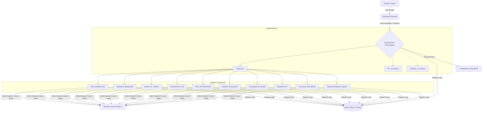

# SOFI-core — Sistema Operacional Financeiro Integrado

> **Auxiliar Corporativo Autônomo** — Centraliza, automatiza, concilia e gerencia fluxos operacionais e financeiros multi-departamentais (UDI e BH) de forma autônoma e sem necessidade de intervenção humana constante.


---

## 📌 Índice

- [Objetivo do Projeto](#-objetivo-do-projeto)
- [Arquitetura do Sistema](#-arquitetura-do-sistema)
- [Estrutura do Repositório](#-estrutura-do-repositório)
- [Departamentos e Módulos](#-departamentos-e-módulos)
- [Estrutura de Dados e Logs](#-estrutura-de-dados-e-logs)
- [Notificações Automáticas](#-notificações-automáticas-smtp)
- [Dependências e Bibliotecas](#-dependências-e-bibliotecas)
- [Configuração de Ambiente](#-configuração-de-ambiente)
- [Como Rodar](#-como-rodar)
- [Deploy em Servidor (Produção)](#-deploy-em-servidor-produção)
- [Manutenção e Resolução de Problemas](#-manutenção-e-resolução-de-problemas)
- [Diretrizes de Governança e Contribuição](#-diretrizes-de-governança-e-contribuição)

---

## 🎯 Objetivo do Projeto

O **SOFI** foi idealizado para sanar e automatizar o gargalo de tarefas repetitivas e manuais do setor financeiro de uma empresa franqueada do **Grupo Boticário**, que atende a **43 lojas** divididas entre as regiões de **Uberlândia (UDI)** e **Belo Horizonte (BH)**. 

O que começou como automações isoladas evoluiu para um **Hub Corporativo Centralizado**. O sistema atua como um **ativo estratégico permanente da empresa**, totalmente documentado, versionado no Git e livre de qualquer dependência pessoal para a execução ou manutenção do fluxo de negócios.

### Principais Resultados Obtidos
* **Redução de tempo operacional:** De 2h a 3h diárias para apenas **5 minutos**.
* **Eficiência do Assistente Financeiro:** Mais de **80%** das atividades repetitivas foram automatizadas.
* **Processamento de E-mails de Venda Direta (VD):** Importação concluída em apenas **2 minutos** automaticamente.
* **Escalabilidade:** Geração e processamento automático do extrato de **42 lojas**.
* **Confiabilidade:** Scheduler com retry automático (até 3 tentativas por job) e notificação por e-mail.

---

## 🏗️ Arquitetura do Sistema

O sistema é desenhado de forma desacoplada: a interface visual (dashboard) atua estritamente como visualizadora e disparadora, enquanto os scripts reais processam a lógica de negócios em background, registrando todo o ciclo de vida no banco de dados SQLite. Ao final da execução dos jobs agendados, o módulo Notifier envia um e-mail HTML consolidado via Gmail SMTP.



---

## 📂 Estrutura do Repositório

```text
sofi-core/
│
├── core/                          # Utilitários compartilhados do núcleo
│   ├── __init__.py                # Marca o pacote core
│   ├── database/
│   │   ├── __init__.py
│   │   ├── logger.py              # Decorator de captura de saídas e gravação no DB
│   │   └── sofi.db                # Banco SQLite de logs e histórico (~1.2 MB)
│   ├── notifier/                  # 🆕 Módulo de notificações por e-mail
│   │   ├── __init__.py
│   │   └── smtp_notifier.py       # Envio de e-mail HTML consolidado via Gmail SMTP
│   ├── scheduler/
│   │   ├── __init__.py
│   │   ├── scheduler.py           # Orquestrador central de jobs com retry automático
│   │   ├── scheduler_config.json  # Configurações de horários e jobs dos cron jobs
│   │   └── scheduler_status.json  # Estado persistido do scheduler (heartbeat, próximo job)
│   └── sofi_env.py                # Carregador inteligente do .env raiz e .env.local
│
├── dashboard/                     # Interface Web (Streamlit Hub)
│   ├── .streamlit/                # Configurações locais do Streamlit
│   ├── app.py                     # Portal de Entrada (inclui singleton do Scheduler)
│   ├── style.css                  # Folha de estilo visual (Padrão Sage, ~17 KB)
│   ├── components/
│   │   └── layout.py              # Cabeçalho, rodapé, scheduler badge e navbar estilo Sage
│   └── pages/
│       ├── financeiro.py          # Dashboard do Financeiro (com status do Scheduler)
│       ├── modulos.py             # 🆕 Hub de Módulos Operacionais (XML, Extranet, Retaguarda)
│       ├── extranet.py            # Execução manual e console da Extranet
│       ├── retaguarda.py          # Execução manual e console da Retaguarda
│       ├── xml.py                 # Gerenciamento de Notas e relatórios Cálamo
│       ├── rh.py                  # Dashboard do RH (Placeholder)
│       └── compras.py             # Dashboard de Compras (Placeholder)
│
├── database/                      # Réplica WAL do SQLite (sofi.db-shm, sofi.db-wal)
│
├── departments/                   # Código dos Departamentos
│   ├── financeiro/
│   │   ├── README.md              # Documentação das automações financeiras
│   │   ├── .env.local             # Variáveis de ambiente exclusivas do Financeiro
│   │   ├── dashboard/             # (Reservado) Dashboards embarcados do financeiro
│   │   └── modules/               # Scripts e automações de robôs
│   │       ├── AUTOMAÇÃO EMAILS VD/   # Monitor automático de caixas do Outlook
│   │       │   ├── monitor_emails_vd.py      # Monitor UDI (3 caixas COM/Outlook)
│   │       │   ├── automacao_outlook_vd.py    # Processador standalone VD
│   │       │   ├── iniciar_monitor.bat        # Script .bat para iniciar o serviço
│   │       │   └── BH/
│   │       │       └── monitor_emails_vd_BH.py # 🆕 Monitor BH separado (3 caixas)
│   │       ├── conciliacao_venda/             # 🆕 Conciliação automática de vendas
│   │       │   ├── robo_conciliacao_omini.py          # RPA Omnichannel (drag-and-drop)
│   │       │   ├── robo_conciliacao_omini_gui.py      # Versão GUI (CustomTkinter)
│   │       │   ├── robo_conciliacao_oficial_complexos.py # Casos 1-para-N com checkpoint
│   │       │   ├── robo_conciliacao.py                # Versão base/auxiliar
│   │       │   ├── robo_planilha.py                   # Leitor de planilhas de fechamento
│   │       │   ├── app_caixa.py                       # Módulo central de caixa
│   │       │   └── dist_rebuild_omini/                # Executáveis .exe compilados
│   │       ├── depositos/                     # 🆕 Lançamento de depósitos via API
│   │       │   └── AUTOMACOES DE DEPOSITO/
│   │       │       ├── script_depositos.py            # Script de lançamento por API
│   │       │       ├── capturar_token.py              # 🆕 Captura de token de sessão via Playwright
│   │       │       ├── mvp_deposito_21061.py          # MVP de teste por loja
│   │       │       └── lojas.xlsx                     # Mapeamento de lojas e IDs
│   │       ├── extranet/                      # Robôs Playwright de vendas extranet
│   │       │   ├── BH/
│   │       │   │   └── extranet_reports_bh.py
│   │       │   └── UDI/
│   │       │       └── extranet_reports_udi.py
│   │       ├── fluxo_caixa/                   # 🆕 Extrator de Fluxo Analítico DFC
│   │       │   ├── extrator_dfc.py                    # DFC UDI (FinançasGB → rede)
│   │       │   └── extrator_dfc_bh.py                 # DFC BH (FinançasGB → rede)
│   │       ├── retaguarda/                    # Relatórios de faturamento
│   │       │   ├── extrator_retaguarda.py             # Extrator unificado UDI/BH
│   │       │   └── executar_relatorio.bat             # Script .bat para disparo manual
│   │       ├── xml/                           # Leitor e gerador de planilha de notas fiscais
│   │       │   ├── debug_meudanfe.py                  # Download XMLs via API MeuDanfe
│   │       │   ├── leitor_xml.py                      # Parser de XMLs NF-e
│   │       │   ├── conversor_xml_sefaz.py             # 🆕 Conversor MeuDanfe → padrão SEFAZ
│   │       │   ├── gerador_relatorio.py               # 🆕 Gerador de relatórios Cálamo (Excel COM)
│   │       │   ├── read_xls.py                        # Leitor auxiliar de .xls legados
│   │       │   └── regras_prazo.txt                   # Config de prazos de pagamento por PDV
│   │       └── importar_financas.py           # Upload automático no FinançasGB (Playwright)
│   │
│   ├── rh/
│   │   ├── README.md
│   │   ├── .env.local
│   │   └── modules/               # Futura triagem automatizada com IA
│   │
│   └── compras/
│       ├── README.md
│       ├── .env.local
│       └── modules/               # Mapeamentos e cálculos de compras
│
├── docs/                          # Documentações antigas e complementares
│   ├── README.md                  # Documentação legada detalhada
│   ├── .env.example               # Template de .env legado
│   └── referencia_MODULOSxPORTAIS.md  # Referência de módulos e portais
│
├── MDS/                           # Documentos conceituais e planos de ação
│   ├── SOF-conceito.html          # Conceito original do SOFI (HTML)
│   ├── SOFI.html                  # Apresentação detalhada (HTML)
│   ├── frontend.md                # Especificação do frontend
│   ├── plano_acao_mvp_sofi_hub_25_dias.md  # Plano de ação do MVP
│   └── plano_acao_sofi_hub_apresentacao.pdf # Plano de ação em PDF
│
├── obisidian/SOFI CORE/           # Vault Obsidian para documentação interna
├── scratch/                       # Scripts de teste e depuração
│   └── test_logger.py             # Teste do sistema de logging
│
├── .env                           # Credenciais compartilhadas globais (NÃO versionado)
├── .env.example                   # Template global de credenciais
├── .gitignore                     # Filtro de arquivos para o Git
├── requirements.txt               # Dependências do projeto
└── LICENSE                        # Licença do projeto
```

---

## 💼 Departamentos e Módulos

### 1. Departamento Financeiro

| Módulo | Tipo / Script | Portais Integrados | Status | Descrição |
| :--- | :--- | :--- | :--- | :--- |
| **SOFI Fluxo Analítico DFC** | `extrator_dfc.py` / `extrator_dfc_bh.py` | FinançasGB | ✅ Ativo | Extrai automaticamente o relatório de Fluxo Analítico (DFC) do FinançasGB para UDI e BH, preenchendo filtros, aguardando geração dinâmica e salvando o Excel na rede `Z:\` com estrutura `ANO/MÊS/DIA`. |
| **SOFI Retaguarda** | `extrator_retaguarda.py` | Retaguarda / FinançasGB | ✅ Ativo | Extrai relatórios de faturamento diário da Retaguarda para UDI e BH. Possui script `.bat` para disparo manual e integração com importador de finanças. |
| **SOFI Emails VD** | `monitor_emails_vd.py` | Outlook Desktop (COM) | ✅ Ativo | Monitora em background novas caixas de e-mail de Venda Direta (3 UDI + 3 BH), extrai os anexos XLSX, converte para XLS (compatível com o Oracle) e salva na Rede Z:\. Possui script `.bat` para inicialização. |
| **SOFI Emails VD BH** | `monitor_emails_vd_BH.py` | Outlook Desktop (COM) | ✅ Ativo | Monitor separado e dedicado para as 3 caixas de BH, com log independente (`monitor_vd.log`). |
| **SOFI Extranet** | `extranet_reports_udi/bh.py` | Extranet Boticário | ✅ Ativo | Acessa a extranet com Playwright, baixa o CSV de vendas diárias D-1 e chama o importador de finanças. |
| **SOFI XML / MeuDanfe** | `debug_meudanfe.py` | API MeuDanfe v2 | ✅ Ativo | Busca chaves de acesso NFe nas planilhas, envia e baixa XMLs da SEFAZ via API MeuDanfe, gerando a planilha de auditoria. |
| **SOFI Conversor XML** | `conversor_xml_sefaz.py` | Interno (offline) | ✅ Ativo | Converte XMLs de NF-e do formato proprietário MeuDanfe para o padrão estrutural oficial da SEFAZ (nfeProc v4.00), reordenando todos os sub-elementos recursivamente conforme o Manual de Integração NF-e. |
| **SOFI Relatório Cálamo** | `gerador_relatorio.py` | Excel COM (win32com) | ✅ Ativo | Gera automaticamente 4 relatórios formatados (Geral e Matheus, para BH e UDI) a partir dos XMLs processados, com cálculos de ICMS ST, resumo por canal (Loja/VD/Eudora), prazos de pagamento configuráveis por PDV e cores alternadas por loja. |
| **SOFI Importa** | `importar_financas.py` | FinançasGB | ✅ Ativo | Utilitário compartilhado via Playwright que realiza login no portal (com stealth anti-bot, bypass de onboarding e limpeza de popups) e faz o upload automático dos arquivos extraídos. Possui modo standalone interativo e modo função. |
| **SOFI Conciliação** | `robo_conciliacao_omini*.py` | FinançasGB / Selenium | ✅ Ativo | RPA de conciliação financeira automática que realiza drag-and-drop de caixas (Laranja/Azul) no portal FinançasGB para dar baixa em pagamentos Omnichannel. Inclui versão GUI (CustomTkinter), sistema de checkpoint para retomada após falhas, e tratamento de modais de justificativa. |
| **SOFI Depósitos** | `script_depositos.py` | FinançasGB API | 🔄 Em Evolução | Automação de lançamento de depósitos identificados via API REST. Inclui captura automática de token de sessão via Playwright e mapeamento de lojas em planilha. |

### 2. Recursos Humanos (RH)
* **Triagem de Currículos:** Sistema que utilizará IA para processar currículos recebidos em massa e classificá-los para vagas abertas. *(Status: 🕐 Em Breve)*

### 3. Compras
* **Mapeador de Insumos:** Consolidação automática de tabelas de custos de compras corporativas. *(Status: 🕐 Em Breve)*

---

## 🗄️ Estrutura de Dados e Logs

Toda a governança de execuções do sistema é mantida de forma centralizada em um banco de dados local **SQLite** com modo **WAL** (Write-Ahead Logging) para suportar leituras simultâneas do Streamlit sem bloquear escritas.

### 1. Banco de Dados SQLite (`core/database/sofi.db`)
Tabela principal: `execution_logs`
```sql
CREATE TABLE IF NOT EXISTS execution_logs (
    id INTEGER PRIMARY KEY AUTOINCREMENT,
    modulo TEXT,                             -- Nome do script ou módulo
    status TEXT,                             -- INICIADO, SUCESSO, ERRO, INFO, AVISO
    mensagem TEXT,                           -- Saída de texto do terminal/exceções
    timestamp DATETIME DEFAULT CURRENT_TIMESTAMP,
    usuario TEXT                             -- Usuário do sistema operacional
);
```

### 2. Captura de Logs Dinâmica (`core/database/logger.py`)
Qualquer script em Python do projeto pode ser envelopado pelo decorator `@log_execution(modulo="NomeDoModulo")`. Esse decorator realiza as seguintes tarefas automaticamente:
1. Registra um registro inicial com status `INICIADO`.
2. Intercepta as saídas padrões `sys.stdout` e `sys.stderr` via `DBStreamCatcher`.
3. Direciona qualquer `print()` ou `traceback` tanto para o console real quanto para a coluna `mensagem` no banco de dados SQLite correspondente àquela execução (append incremental).
4. Ao final da execução da função, altera o status para `SUCESSO` ou `ERRO` no banco.

### 3. Estado Persistido do Scheduler (`core/scheduler/scheduler_status.json`)
O scheduler grava um heartbeat periódico com seu estado atual:
```json
{
  "last_heartbeat": "2026-07-21T15:54:28.595898",
  "running": true,
  "next_job": "SOFI Daily Jobs 09:00",
  "jobs": [{"name": "Extranet BH", "hour": 9, "minute": 0}, ...]
}
```

---

## 📧 Notificações Automáticas (SMTP)

O módulo `core/notifier/smtp_notifier.py` envia um **e-mail HTML consolidado** ao final da execução de todos os jobs agendados, via **Gmail SMTP (TLS)**.

### Funcionalidades:
* **E-mail HTML rico:** Template com gradiente dinâmico (verde para sucesso, vermelho para erros), tabela de jobs com badges de status, detalhes de tentativas/duração e trecho de erros em fonte monospace.
* **Cabeçalho dinâmico:** Muda automaticamente entre "Tudo OK!" e "Atenção, há erros!" com cores correspondentes.
* **Rodapé informativo:** Exibe hostname do servidor, usuário do SO e timestamp da execução.
* **Controle granular:** Configuração de `send_on_success` e `send_on_error` via `scheduler_config.json` para enviar e-mail somente em cenários desejados.
* **Status possíveis:** `SUCESSO`, `ERRO`, `FALHA PERMANENTE` e `DESABILITADO`.
* **Zero dependências externas:** Usa apenas `smtplib` e `email.mime` nativos do Python.

### Variáveis de Ambiente:
```env
SMTP_SERVER=smtp.gmail.com
SMTP_PORT=587
SMTP_USER=sofi.notifier@gmail.com
SMTP_PASSWORD=                      # Senha de App de 16 chars
SCHEDULER_NOTIFY_EMAILS=email1@empresa.com;email2@empresa.com
```

---

## ⏰ Scheduler — Jobs Agendados em Produção

O scheduler (`core/scheduler/scheduler.py`) executa via **APScheduler (BackgroundScheduler)** com timezone `America/Sao_Paulo`. Os jobs são agrupados por horário e executados sequencialmente dentro de cada grupo.

### Tabela de Jobs Ativos

| Job | Script | Horário | Retry | Delay entre tentativas |
| :--- | :--- | :--- | :--- | :--- |
| Fluxo Analítico DFC UDI | `fluxo_caixa/extrator_dfc.py` | 08:00 | 3x | 120s |
| Fluxo Analítico DFC BH | `fluxo_caixa/extrator_dfc_bh.py` | 08:15 | 3x | 120s |
| Retaguarda UDI | `retaguarda/extrator_retaguarda.py` | 08:30 | 3x | 120s |
| Retaguarda BH | `retaguarda/extrator_retaguarda.py` | 08:45 | 3x | 120s |
| Extranet BH | `extranet/BH/extranet_reports_bh.py` | 09:00 | 3x | 120s |
| Extranet UDI | `extranet/UDI/extranet_reports_udi.py` | 09:15 | 3x | 120s |

### Lógica de Retry por Exit Code:
| Exit Code | Significado | Ação |
| :--- | :--- | :--- |
| `0` | SUCESSO | Registra e avança |
| `1` | FALHA TRANSITÓRIA (ex: timeout Playwright) | Retry até `max_attempts` |
| `2` | FALHA PERMANENTE (ex: dados vazios) | Sem retry |

---

## 🛠️ Dependências e Bibliotecas

O projeto exige **Python 3.10+** (recomendado Python 3.11 no ambiente de produção do Windows Server). Abaixo estão listadas as bibliotecas fundamentais:

```text
# Visualização e Dashboard
streamlit>=1.58.0      # Criação de interface rica do Hub

# Automação de Navegadores (Web Scraping)
playwright>=1.60.0     # Interação ultra veloz e stealth com os portais corporativos
selenium>=4.0.0        # Automação web para conciliação financeira (drag-and-drop)
webdriver-manager>=4.0.0 # Gerenciamento automático do ChromeDriver

# Processamento de Dados e Planilhas
pandas>=2.0.0          # Manipulação de tabelas e logs
openpyxl>=3.0.0        # Edição, estilização e salvamento em formato Excel (.xlsx)
xlrd>=2.0.0            # Leitura de arquivos Excel legados (.xls) do SAP/Oracle
xlwt>=1.3.0            # Escrita de arquivos Excel legados (.xls)
xlwings>=0.30.0        # Integração avançada com Excel via COM

# Agendamento e Execuções
apscheduler>=3.11.0    # Gerenciamento de tarefas em background no servidor
python-dotenv>=1.0.0   # Carregamento automatizado de variáveis de ambiente

# Utilitários Windows e Integração com Office local (Outlook/Excel)
pywin32>=306           # Conector COM para controlar Outlook (Emails VD) e Excel nativo
lxml>=4.9.0            # Parser otimizado para arquivos XML de notas fiscais

# Chamadas de Rede e API
requests>=2.28.0       # Consumo de APIs (MeuDanfe, Depósitos, etc.)
```

---

## ⚙️ Configuração de Ambiente

### Pré-requisitos
1. **Python 3.10+** instalado (marque "Add Python to PATH" na instalação).
2. **Google Chrome** ou **Microsoft Edge** instalado no servidor.
3. Acesso à **Rede Z:\** (servidor local de arquivos `/srv-dc01/File Server/`).
4. **Microsoft Excel** instalado (para o módulo Gerador de Relatórios Cálamo via COM).
5. **Microsoft Outlook** instalado (para o módulo Monitor Emails VD via COM).

### Passo a Passo de Instalação

1. **Clonar o Repositório:**
   ```bash
   git clone https://github.com/[sua-organizacao]/sofi-core.git
   cd sofi-core
   ```

2. **Instalar Dependências:**
   ```bash
   pip install -r requirements.txt
   ```

3. **Instalar Navegadores do Playwright:**
   ```bash
   playwright install chromium
   ```

4. **Configurar as Variáveis de Ambiente:**
   Copie o arquivo de exemplo e preencha as variáveis correspondentes:
   ```bash
   cp .env.example .env
   ```
   > ⚠️ **IMPORTANTE:** Nunca altere ou adicione senhas direto nos códigos-fonte. O arquivo `.env` global fica na raiz do projeto e **não deve** ser subido para o repositório. Arquivos `.env.local` específicos podem ser criados dentro das pastas de departamentos (`departments/[dept]/.env.local`).

---

## 🚀 Como Rodar

### Rodar o Dashboard Completo (Web)
O dashboard do Streamlit é a central administrativa do SOFI. Para executá-lo localmente:
```bash
streamlit run dashboard/app.py
```
O console exibirá o endereço local, que geralmente é `http://localhost:8501`.

> **Nota:** O scheduler é inicializado automaticamente como singleton via `st.cache_resource` quando o `app.py` é carregado, garantindo que apenas uma instância do `BackgroundScheduler` exista por processo.

### Rodar Scripts de Módulos Isolados
Se desejar executar um robô de forma independente e isolada:
```bash
# Exemplo 1: Fluxo Analítico DFC UDI
cd departments/financeiro/modules/fluxo_caixa
python extrator_dfc.py --data 21/07/2026

# Exemplo 2: Extrator da Retaguarda para BH
cd departments/financeiro/modules/retaguarda
python extrator_retaguarda.py --unidade BH --data 21/07/2026

# Exemplo 3: Extrator da extranet
cd departments/financeiro/modules/extranet/UDI
python extranet_reports_udi.py

# Exemplo 4: Processamento e geração de relatórios de notas fiscais XML
cd departments/financeiro/modules/xml
python gerador_relatorio.py

# Exemplo 5: Conversor de XMLs para padrão SEFAZ
cd departments/financeiro/modules/xml
python conversor_xml_sefaz.py "T:\13-Publica\XMLS CÁLAMO\Semana 06-07"
python conversor_xml_sefaz.py --arquivo "T:\...\20846_656344.xml" --backup

# Exemplo 6: Importar manualmente para FinançasGB (modo interativo)
cd departments/financeiro/modules
python importar_financas.py
```

---

## ☁️ Deploy em Servidor (Produção)

O SOFI roda de forma contínua em um servidor **Windows Server dedicado** (32GB RAM, i7 12ª geração).

### 1. Registro como Serviço do Windows (NSSM)
Para garantir que o Dashboard e o Scheduler fiquem sempre rodando (mesmo após reinicializações do servidor ou encerramento de sessão de usuários), o sistema é registrado usando o **NSSM (Non-Sucking Service Manager)**:

```powershell
# Executar no terminal do Windows em modo Administrador
nssm.exe install SOFI python.exe "-m streamlit run C:\sofi-core\dashboard\app.py --server.port 8501"

# Iniciar o serviço
nssm.exe start SOFI
```

### 2. Acesso Externo Seguro (Cloudflare Tunnel)
Não há necessidade de liberar portas de entrada ou IPs no firewall corporativo. O acesso externo ao dashboard é exposto de forma criptografada pelo **Cloudflare Tunnel**:

```bash
# Instalar o utilitário cloudflared no servidor Windows
# Autenticar com a conta da corporação
cloudflared tunnel login

# Iniciar túnel apontado para a porta do Streamlit
cloudflared tunnel run [NOME_DO_TUNEL]
```

### 3. Caminhos de Rede (Z:\)
Os módulos de e-mails, relatórios e importações salvam e leem diretamente do servidor local de arquivos da rede.
Certifique-se de que a letra de unidade **Z:\** esteja permanentemente mapeada no usuário do Windows que executa o serviço SOFI para o caminho:
`\\srv-dc01\File Server\05-FIN\FECHAMENTO DE CAIXA\`

---

## 🔧 Manutenção e Resolução de Problemas

### 1. Monitoramento do Status do Scheduler
* O painel no dashboard possui um badge estilizado no topo (estilo Sage) que indica `🟢 Agendados: ativo` ou `🔴 Agendados: pausado`, com exibição do próximo job agendado.
* A tabela de jobs no config (`core/scheduler/scheduler_config.json`) determina os horários de disparo: DFC (8h/8h15), Retaguarda (8h30/8h45), Extranet (9h/9h15).
* O Notifier envia um e-mail consolidado ao final de cada ciclo de execução.

### 2. Verificação de Serviços no Windows
Se o painel web ficar inacessível:
```powershell
# Verificar se o serviço SOFI está rodando
nssm status SOFI

# Reiniciar o serviço em caso de travamentos ou falhas
nssm restart SOFI
```

### 3. Depuração de Logs de Erros
* Para visualizar qualquer falha de execução de script em tempo real, acesse a página do módulo correspondente no menu lateral do Streamlit. A página carrega o console do SQLite.
* Os logs do monitor de e-mails UDI ficam disponíveis em: `departments/financeiro/modules/AUTOMAÇÃO EMAILS VD/monitor_vd.log`.
* Os logs do monitor de e-mails BH ficam disponíveis em: `departments/financeiro/modules/AUTOMAÇÃO EMAILS VD/BH/monitor_vd.log`.
* Logs do scheduler são gravados diretamente no banco SQLite com `modulo="Scheduler"`.
* Logs do notifier são gravados com `modulo="Notifier"`.

### 4. Resolução de Erros Comuns com o Playwright
Se as automações de navegador começarem a falhar por bloqueio de carregamento ou navegador desatualizado:
* Edite o arquivo `.env` e troque `BROWSER_CHANNEL=chrome` por `BROWSER_CHANNEL=msedge`.
* Verifique se a variável `HEADLESS` está configurada como `true` em produção para evitar abertura visual de abas desnecessárias.
* O script `importar_financas.py` inclui stealth anti-bot que remove o atributo `navigator.webdriver` e injeta propriedades realistas de navegação.
* O `DISABLE_HTTP2=true` no `.env` é recomendado para evitar problemas de compatibilidade com proxies corporativos.

### 5. Resolução de Erros com o Gerador de Relatórios Cálamo
* O `gerador_relatorio.py` utiliza `win32com.client.DispatchEx` (nova instância isolada do Excel) para evitar herdar estados corrompidos de sessões anteriores.
* Se o Excel COM travar, finalize manualmente processos `EXCEL.EXE` via Gerenciador de Tarefas antes de reexecutar.

---

## 📜 Diretrizes de Governança e Contribuição

Para garantir a sustentabilidade do código a longo prazo como um ativo permanente da empresa, as seguintes regras são **mandatórias**:

1. **Isolamento de Credenciais:** Nunca salve senhas hardcoded. Utilize `os.getenv()` e documente no `.env.example`.
2. **Carregamento de Variáveis:** Sempre carregue o ambiente no topo de qualquer script usando:
   ```python
   from core.sofi_env import load_sofi_env
   load_sofi_env(department="financeiro") # Ajuste conforme o departamento
   ```
3. **Escrita no Banco de Logs:** Envolva o bloco principal `main()` com `@log_execution(modulo="NomeDoModulo")`.
4. **Acoplamento Zero:** Um departamento (ex: `rh/`) nunca deve importar arquivos ou códigos diretamente de outro (`financeiro/`). Código utilitário comum de infraestrutura deve ser movido para o diretório `core/`.
5. **Histórico Legível:** Mensagens de commit no Git devem ser claras, descritivas e escritas em **Português do Brasil**.
6. **Exit Codes Padrão:** Todo script executado pelo scheduler deve usar: `sys.exit(0)` para sucesso, `sys.exit(1)` para falha transitória (retry) e `sys.exit(2)` para falha permanente (sem retry).
7. **Stealth Anti-Bot:** Scripts que acessam portais corporativos devem usar as constantes `STEALTH_INIT_SCRIPT`, `REALISTIC_USER_AGENT` e `browser_args()` do `importar_financas.py`.

---

*SOFI v2.3.0 · Uso Interno Reservado · Grupo Boticário Franchisee · 2026*
