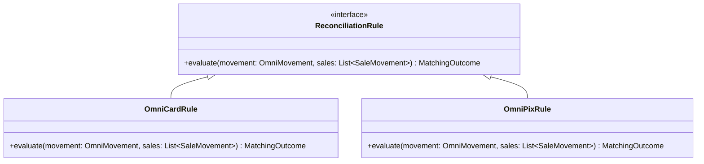

# Especificação Técnica — Motor de Conciliação OMNI v1

> **Status:** Aprovado  
> **Data:** 2026-09-22  
> **Domínio:** Financeiro (`departments/financeiro/`)  
> **Módulo:** `departments/financeiro/modules/conciliacao_omni/`  
> **Modo Operacional:** `REPORT_ONLY` (sem chamadas mutantes a `POST /Conciliar/`)  
> **Referência no Vault:** `[[modulo_conciliacao_omni]]`  

---

## 1. Contexto e Objetivo

O SOFI atua na automação das operações financeiras e de tesouraria de 43 lojas franqueadas do Grupo Boticário (regionais Uberlândia e Belo Horizonte).

A conciliação de recebíveis no ERP corporativo **FinançasGB** para vendas com meio de captura **OMNI** atualmente demanda tempo manual ou robôs legados baseados em simulação visual (drag-and-drop via Selenium). 

O **Motor de Conciliação OMNI v1** moderniza essa operação através do consumo direto das APIs REST internas do FinançasGB, estruturando um pipeline desacoplado entre infraestrutura e regras de negócio.

Na **versão 1**, o motor opera com escopo restrito a **OMNI Cartão** em modo estritamente analítico e de auditoria (**`REPORT_ONLY`**), garantindo o rastreamento histórico de vendas e recebíveis sem efetuar baixas no portal. Transações de **OMNI PIX** são identificadas e segregadas de forma deliberada sob o status **`REGRA_NAO_IMPLEMENTADA`**, sem contaminar as regras de cartão e sem serem classificadas incorretamente como falha de correspondência.

---

## 2. Escopo da Versão 1

### 2.1 Em Escopo (v1)
1. **OMNI Cartão:** Identificação de transações com `MeioDeCaptura = "OMNI"` e modalidade de cartão (Crédito / Débito).
2. **Matching Determinístico:**
   - Critério composto: `EmpresaId` + `Valor` + `CodigoDeAutorizacao`.
   - Tratamento de autorizações com normalização de zeros à esquerda (`strip().lstrip('0')`).
   - Tolerância de precisão em valores monetários (`round(val, 2)`).
3. **Janela Temporal:**
   - **Vendas:** Do primeiro dia do mês corrente (`01/MM/AAAA`) até `D-1`.
   - **Aquisições/Recebíveis:** Do primeiro dia com OMNI pendente detectado no mapa até `D-1`.
4. **Modo `REPORT_ONLY`:** Registro de resultados no SQLite e geração de relatórios detalhados, com trava física contra chamadas a `POST /Conciliar/`.
5. **Autenticação Automática:** Captura de cookies e tokens de sessão via Playwright com cache em disco e renovação transparente.
6. **Rate Limiting com Jitter:** Pausa randômica de 1 a 6 segundos entre chamadas HTTP sequenciais à API.
7. **Controle de Cursor:** Persistência em tabela SQLite `processing_days` para controle contínuo dos dias ativos.

### 2.2 Fora de Escopo (Fases Futuras)
1. **Regra OMNI PIX:** Será implementada como regra especializada independente (`OmniPixRule`) em fase posterior após homologação dos dados.
2. **Baixa Ativa (`POST /Conciliar/`):** Desativada na v1; será liberada apenas após homologação com a equipe financeira.

---

## 3. Arquitetura de Componentes e Estrutura de Pacotes

O código residirá em [`departments/financeiro/modules/conciliacao_omni/`](file:///C:/Users/Mateus%20Henrique/Documents/GitHub/sofi-core/departments/financeiro/modules/conciliacao_omni/):

```text
departments/financeiro/modules/conciliacao_omni/
├── __init__.py
├── auth/
│   ├── __init__.py
│   └── session_manager.py     # Automação Playwright headless, login e cache de cookies (.session_cookie.json)
├── client/
│   ├── __init__.py
│   └── financas_client.py     # Consumo HTTP tipado (/List/, /GetMovimentosDeVendas/, /GetConfirmacaoDoCartao/)
├── domain/
│   ├── __init__.py
│   ├── enums.py               # MovementStatus e RuleType
│   ├── models.py              # Dataclasses imutáveis (SaleMovement, CardMovement, ProcessingDay, etc.)
│   └── rules/
│       ├── __init__.py
│       ├── base.py            # Interface abstrata ReconciliationRule
│       ├── omni_card.py       # Regra v1 ativa: OmniCardRule (EmpresaId + Valor + Autorização)
│       └── omni_pix.py        # Regra v1 isolada: OmniPixRule (REGRA_NAO_IMPLEMENTADA)
├── storage/
│   ├── __init__.py
│   └── repository.py          # Repositório SQLite (cursor de dias, movimentos, vendas e auditoria)
├── engine.py                  # Orquestrador do ciclo (descoberta -> coleta -> classificação -> matching -> persistência)
├── reporter.py                # Consolidador e formatador do relatório de conciliação
└── main.py                    # Entrypoint CLI com @log_execution e exit codes padronizados (0, 1, 2, 3)
```

---

## 4. Contratos de API e Autenticação

### 4.1 Endpoints do FinançasGB (`https://financasgb.grupoboticario.com.br/ConciliacaoAPI/`)

1. **Mapa de Pendências (`/List/`):**
   - **Método:** `GET`
   - **URL:** `/ConciliacaoAPI/List/?data={data_iso}&empresasIds={empresas}&firstDisplay=true`
   - **Campos Relevantes:**
     - `Data`: ISO-8601 da data de referência.
     - `MovimentosPendentes`: Quantidade de pendências no dia (se > 0, dia é candidato a processamento).
     - `TodosRegistrosConciliados`: Booleano indicando fechamento integral do dia.

2. **Vendas do Período (`/GetMovimentosDeVendas/`):**
   - **Método:** `GET`
   - **URL:** `/ConciliacaoAPI/GetMovimentosDeVendas/?de={de_iso}&ate={ate_iso}&empresasIds={empresas}`
   - **Campos Relevantes:**
     - `_id`: Identificador único da venda (utilizado para matching e vínculo).
     - `EmpresaId`: Identificador da loja.
     - `Valor`: Valor numérico da venda.
     - `Data`: Data da venda.
     - `Venda.CodigoDeAutorizacao` ou `Venda.Autorizacao`: Código de autorização bancária.

3. **Recebíveis/Movimentos de Cartão (`/GetConfirmacaoDoCartao/`):**
   - **Método:** `GET`
   - **URL:** `/ConciliacaoAPI/GetConfirmacaoDoCartao/?data={data_iso}&conciliado=false&empresasIds=&exibirMovimentosDeAjustes=false`
   - **Campos Relevantes:**
     - `_id`: Identificador do recebível na adquirente.
     - `MeioDeCaptura`: Classificação de captura (deve ser `"OMNI"`).
     - `EmpresaId`: Identificador da loja.
     - `Valor`: Valor da transação.
     - `Modalidade` / `Operadora`: Detalhes de bandeira e meio de pagamento.
     - `Vendas[0].CodigoDeAutorizacao`: Código de autorização para cruzamento.
     - `Vendas[0].NSU`: NSU da transação.

4. **Conciliar (`/Conciliar/`):**
   - **Método:** `POST` (Json body)
   - **URL:** `/ConciliacaoAPI/Conciliar/`
   - **Payload do Contrato:**
     ```json
     {
       "cartoes": ["id_adquirente"],
       "ids": ["id_venda"],
       "tipo": false,
       "justificativa": "LANÇAMENTO COM CONCILIAÇÃO MANUAL DEVIDO INCONCISTENCIA DE DATA DE CREDITO NOVO PORTAL MOOZ CARTOES",
       "errors": []
     }
     ```
   - **Trava v1:** O cliente HTTP possui proteção interna que bloqueia o envio caso `mode == 'REPORT_ONLY'`, levantando alerta de segurança.

### 4.2 Fluxo de Autenticação Playwright
- **Credenciais:** Lidas do `.env` central (`FINANCAS_UDI_USER` / `FINANCAS_UDI_PASS` e `FINANCAS_URL`).
- **Navegação:**
  1. Acessa `FINANCAS_URL` e autentica-se.
  2. Navega para `//*[@id="mfe-sidebar-react"]/div/nav/div[2]/div[3]/a/p`.
  3. Aguarda resposta do portal e clica no checkbox `//*[@id="tabstrip-1"]/div[1]/div/label[2]/input`.
  4. Extrai cookies de sessão do `BrowserContext`.
- **Cache Local:** Salvo em `.session_cookie.json` com TTL de 2 horas. Reutilizado diretamente em `requests.Session` e renovado automaticamente se a API retornar `401 Unauthorized` ou `403 Forbidden`.

### 4.3 Rate Limit e Jitter
Entre cada chamada de API feita pelo `FinancasClient`, aplica-se:
```python
time.sleep(random.uniform(1.0, 6.0))
```

---

## 5. Modelo de Dados e Persistência SQLite

O banco `omni_conciliacao.db` reside no diretório do módulo com SQLite configurado em modo WAL (`PRAGMA journal_mode=WAL`).

### 5.1 Enums de Domínio
```python
class MovementStatus(str, Enum):
    NOVO = "NOVO"
    AGUARDANDO_VENDA = "AGUARDANDO_VENDA"
    MATCH = "MATCH"
    AMBIGUO = "AMBIGUO"
    SEM_CORRESPONDENCIA = "SEM_CORRESPONDENCIA"
    REGRA_NAO_IMPLEMENTADA = "REGRA_NAO_IMPLEMENTADA"
    CONCILIADO = "CONCILIADO"
    ERRO = "ERRO"

class RuleType(str, Enum):
    OMNI_CARD = "OMNI_CARD"
    OMNI_PIX = "OMNI_PIX"
    OUTROS = "OUTROS"
```

### 5.2 Esquema DDL

```sql
CREATE TABLE IF NOT EXISTS processing_days (
    date TEXT PRIMARY KEY,
    has_pending BOOLEAN NOT NULL DEFAULT 0,
    has_omni BOOLEAN NOT NULL DEFAULT 0,
    pending_omni_count INTEGER NOT NULL DEFAULT 0,
    last_checked_at TIMESTAMP,
    status TEXT NOT NULL
);

CREATE TABLE IF NOT EXISTS omni_movements (
    external_id TEXT PRIMARY KEY,
    date TEXT NOT NULL,
    empresa_id TEXT NOT NULL,
    valor REAL NOT NULL,
    meio_captura TEXT NOT NULL,
    forma_pagamento TEXT NOT NULL,
    codigo_autorizacao TEXT,
    nsu TEXT,
    tipo_regra TEXT NOT NULL,
    status TEXT NOT NULL,
    matched_sale_id TEXT,
    last_attempt_at TIMESTAMP,
    attempt_count INTEGER DEFAULT 0,
    raw_json TEXT
);

CREATE TABLE IF NOT EXISTS sales (
    id TEXT PRIMARY KEY,
    date TEXT NOT NULL,
    empresa_id TEXT NOT NULL,
    valor REAL NOT NULL,
    documento TEXT,
    codigo_autorizacao TEXT,
    nsu TEXT,
    modalidade TEXT,
    raw_json TEXT
);

CREATE TABLE IF NOT EXISTS matching_results (
    id INTEGER PRIMARY KEY AUTOINCREMENT,
    movement_id TEXT NOT NULL,
    sale_id TEXT,
    status TEXT NOT NULL,
    rule_type TEXT NOT NULL,
    matched_at TIMESTAMP DEFAULT CURRENT_TIMESTAMP,
    details TEXT,
    FOREIGN KEY(movement_id) REFERENCES omni_movements(external_id)
);

CREATE TABLE IF NOT EXISTS executions (
    id INTEGER PRIMARY KEY AUTOINCREMENT,
    started_at TIMESTAMP DEFAULT CURRENT_TIMESTAMP,
    finished_at TIMESTAMP,
    status TEXT NOT NULL,
    mode TEXT NOT NULL DEFAULT 'REPORT_ONLY',
    summary_json TEXT
);
```

---

## 6. Motor de Regras e Ciclo de Execução

### 6.1 Regras de Conciliação (`ReconciliationRule`)



1. **`OmniCardRule`:**
   - Filtra vendas candidatas:
     - `sale.empresa_id == movement.empresa_id`
     - `round(sale.valor, 2) == round(movement.valor, 2)`
     - `sale.codigo_autorizacao.strip().lstrip('0') == movement.codigo_autorizacao.strip().lstrip('0')`
   - Resultados:
     - `0` vendas $\rightarrow$ `MovementStatus.AGUARDANDO_VENDA`
     - `1` venda $\rightarrow$ `MovementStatus.MATCH` (`matched_sale_id = sale.id`)
     - `> 1` vendas $\rightarrow$ `MovementStatus.AMBIGUO` (auditoria com IDs concorrentes)

2. **`OmniPixRule`:**
   - Não avalia critérios de vendas.
   - Retorna diretamente `MovementStatus.REGRA_NAO_IMPLEMENTADA`.

### 6.2 Ciclo de Orquestração (`engine.py`)
1. **Descoberta:** Consulta `/List/` $\rightarrow$ atualiza `processing_days`.
2. **Coleta de Vendas:** Consulta `/GetMovimentosDeVendas/` para `01` a `D-1` $\rightarrow$ persiste/atualiza em `sales`.
3. **Iteração dos Dias Ativos:** Para cada dia com pendências $\rightarrow$ `/GetConfirmacaoDoCartao/`.
4. **Classificação & Execução:**
   - Movimentos com `MeioDeCaptura != "OMNI"` são descartados.
   - PIX despachado para `OmniPixRule`.
   - Cartões despachados para `OmniCardRule`.
5. **Atualização do Repositório:** Grava `omni_movements`, `matching_results` e recalcula status em `processing_days`.
6. **Relatório:** Despacha consolidação para `reporter.py`.

---

## 7. Formato do Relatório e Exit Codes

### 7.1 Relatório Operacional
Exibido em console e gravado em arquivo texto com segregação explícita:

```text
================================================================================
SOFI - MOTOR DE CONCILIAÇÃO OMNI v1 (MODO REPORT_ONLY)
Execução: 22/09/2026 17:30:00 | Janela Vendas: 01/09 a 21/09
================================================================================

[DETALHAMENTO POR DIA PENDENTE]
--------------------------------------------------------------------------------
Dia: 07/09/2026 | Status do Dia: PENDENTE_OMNI
  OMNI CARTÃO:
    Total: 12 movimentos
    - MATCH:                   10 (R$ 3.810,00)
    - AGUARDANDO VENDA:         2 (R$   440,80)
    - AMBÍGUO:                  0
  OMNI PIX:
    Total: 4 movimentos
    - REGRA NÃO IMPLEMENTADA:   4 (R$   820,00)

--------------------------------------------------------------------------------
[RESUMO CONSOLIDADO DO PERÍODO]
--------------------------------------------------------------------------------
Dias Verificados no Cursor: 21
Dias com OMNI Pendente:      9

OMNI CARTÃO:
  MATCH (Correspondência Exata):   176
  AGUARDANDO VENDA:                 18
  AMBÍGUO (Múltiplas Vendas):        6

OMNI PIX:
  REGRA NÃO IMPLEMENTADA:           24
================================================================================
```

### 7.2 Exit Codes
- `EXIT_OK = 0`: Sucesso integral na coleta e geração do relatório.
- `EXIT_RETRYABLE = 1`: Oscilação transitória de rede ou timeout de API.
- `EXIT_PERMANENT = 2`: Erro estrutural, falha irrecuperável ou credenciais inválidas.
- `EXIT_SEM_FATURAMENTO = 3`: Nenhuma pendência OMNI identificada no cursor.

---

## 8. Estratégia de Testes TDD

Os testes serão estruturados em `tests/financeiro/conciliacao_omni/`:
- `test_models.py`: Validação de conversão e parsing dos payloads da API.
- `test_omni_card_rule.py`: Cobertura de cenários de matching (0, 1 e múltiplos, zeros à esquerda e floats).
- `test_omni_pix_rule.py`: Validação do isolamento de PIX e retorno de `REGRA_NAO_IMPLEMENTADA`.
- `test_repository.py`: CRUD em SQLite em memória com verificação de constraints e contagem de tentativas.
- `test_financas_client.py`: Mocks HTTP com verificação de retries, rate limit com jitter (1 a 6s) e trava de `REPORT_ONLY`.
- `test_engine.py`: Teste de integração ponta a ponta simulando o ciclo completo com mocks.
