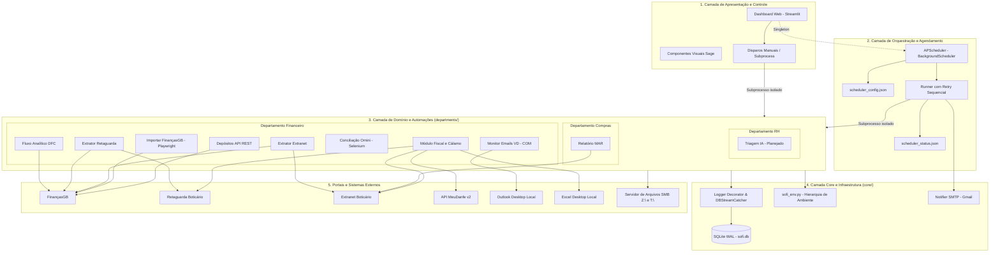

# 🏗️ Arquitetura do Sistema SOFI

> **Status:** Ativo / Produção  
> **Versão do Sistema:** 2.3.0  
> **Classificação:** Arquitetura de Plataforma Corporativa  

---

## 1. Visão Geral da Arquitetura

O **SOFI (Sistema Operacional Financeiro Integrado)** é projetado sob o padrão de **arquitetura desacoplada e orientada a processos independentes**, concebido especificamente para operar de forma resiliente 24/7 em ambiente Windows Server corporativo.

A premissa fundamental da arquitetura é que **a interface visual nunca executa regras de negócio bloqueantes diretamente**, e **as automações são processos autônomos que sobrevivem a falhas de frontend ou outros módulos**.

---

## 2. Princípios de Design Arquitetural

### 2.1 Desacoplamento Estrito (Decoupled Execution)
- O dashboard Streamlit (`dashboard/app.py`) funciona estritamente como visualizador e console de monitoramento.
- Quando o usuário dispara uma ação manual pela interface, o Streamlit não roda o código na mesma thread/processo: ele invoca `subprocess.run()` criando um novo processo ou console isolado no Windows.
- O scheduler roda em background como um singleton (`@st.cache_resource` no Streamlit) e também executa cada rotina em um subprocesso Python dedicado via `subprocess.run()`.

### 2.2 Isolamento Modular por Domínio (Zero Cross-Department Coupling)
- A lógica de negócio reside dentro de `departments/<nome_departamento>/modules/`.
- **Regra Fato:** Nenhum departamento pode importar código de outro departamento (`departments/rh/` nunca importa de `departments/financeiro/`).
- Funcionalidades utilitárias transversais ou de infraestrutura (banco de dados, logging, envio de e-mails, orquestração, carregador de ambiente) devem obrigatoriamente residir em `core/`.

### 2.3 Resiliência e Máquina de Estados por Exit Codes
O orquestrador (`core/scheduler/scheduler.py`) padroniza o ciclo de vida e a recuperação de falhas através de códigos de saída numéricos retornados pelos processos:

| Exit Code | Constante | Significado | Comportamento do Scheduler |
| :--- | :--- | :--- | :--- |
| `0` | `EXIT_OK` | Execução concluída com sucesso | Registra log, atualiza status e prossegue para o próximo job. |
| `1` | `EXIT_RETRYABLE` | Falha transitória (timeout de rede, delay de portal, erro de seletor temporário) | Aplica retry com backoff (ex: até 3 tentativas com 120s de intervalo). |
| `2` | `EXIT_PERMANENT` | Falha permanente (dados ausentes, arquivo corrompido, credencial inválida) | Interrompe imediatamente sem retries desnecessários para economizar recursos. |
| `3` | `EXIT_SEM_FATURAMENTO` | Condição de negócio esperada (sem movimentação no dia/período) | Tratado como informativo / sucesso sem movimentação. |

### 2.4 Observabilidade Transparente e Concorrência Não-Bloqueante
- O módulo `core/database/logger.py` implementa o decorator `@log_execution(modulo="...")` que substitui `sys.stdout` e `sys.stderr` pelo capturador `DBStreamCatcher`.
- Todo `print()` emitido por scripts de negócio é simultaneamente impresso no console real e anexado na coluna `mensagem` da tabela `execution_logs` no banco SQLite.
- O SQLite opera em modo **WAL (Write-Ahead Logging)** com timeout de conexão configurado em 10 segundos, viabilizando leituras concorrentes pelo Streamlit sem travar as escritas contínuas dos robôs.

---

## 3. Pilha Tecnológica (Stack)

| Componente / Função | Tecnologia Adotada | Racional Técnico |
| :--- | :--- | :--- |
| **Linguagem Base** | Python 3.10+ (Recomendado 3.11) | Compatibilidade com bibliotecas Windows COM e ecossistema de dados. |
| **Frontend / Dashboard** | Streamlit (>= 1.58.0) | Desenvolvimento rápido de painéis com CSS customizado (design system Sage). |
| **Automação Web Primária** | Playwright (>= 1.60.0) | Velocidade, confiabilidade para downloads/uploads, headless em servidor e stealth anti-bot. |
| **Automação Web Específica** | Selenium (>= 4.0.0) | Utilizado no módulo de conciliação devido à necessidade do `ActionChains.drag_and_drop()` físico sobre elementos Knockout.js. |
| **Orquestrador de Jobs** | APScheduler (>= 3.11.0) | Agendador leve em background integrado ao processo Python, sem dependência de cron externo de SO. |
| **Banco de Dados de Auditoria** | SQLite 3 (Nativo com WAL) | Zero dependência de servidor de banco externo para logs do MVP; persistência local leve. |
| **Processamento de Planilhas** | pandas, openpyxl, xlrd, xlwt | Manipulação de formatos legados (.xls gerados por SAP/Oracle) e novos (.xlsx). |
| **Integração Windows Desktop** | pywin32 (win32com) | Interação direta com Microsoft Outlook (leitura de caixas de email) e Microsoft Excel (instâncias COM isoladas para relatórios complexos). |
| **Parser Fiscal** | lxml | Processamento e manipulação estrutural de arquivos XML de NF-e (schema SEFAZ). |
| **Comunicação e Alertas** | smtplib / email.mime (Nativos) | Envio de e-mails em formato HTML consolidado via Gmail SMTP sem dependências de terceiros. |

---

## 4. Estrutura Física do Servidor e Produção

- **Ambiente Host:** Windows Server dedicado (32GB RAM, Intel Core i7 12ª geração).
- **Gerenciamento de Serviço:** O sistema é registrado como serviço do Windows via **NSSM (Non-Sucking Service Manager)** executando o comando Streamlit, garantindo restart automático em boot ou travamentos.
- **Rede e Armazenamento Centralizado:** Unidades mapeadas SMB permanentes:
  - `Z:\` (`\\srv-dc01\File Server\05-FIN\FECHAMENTO DE CAIXA\`)
  - `T:\` (`T:\13-Publica\`)
- **Acesso Externo Seguro:** Exposto via **Cloudflare Tunnel** criptografado, eliminando a abertura de portas ou liberação de IPs em firewall corporativo.

---

## 5. Evidências do Código

- Decorator de log: `core/database/logger.py`
- Mecanismo do scheduler: `core/scheduler/scheduler.py` e `core/scheduler/scheduler_config.json`
- Notificações consolidadas: `core/notifier/smtp_notifier.py`
- Carregamento de ambientes: `core/sofi_env.py`
- Entry point e interface: `dashboard/app.py`, `dashboard/components/layout.py`
