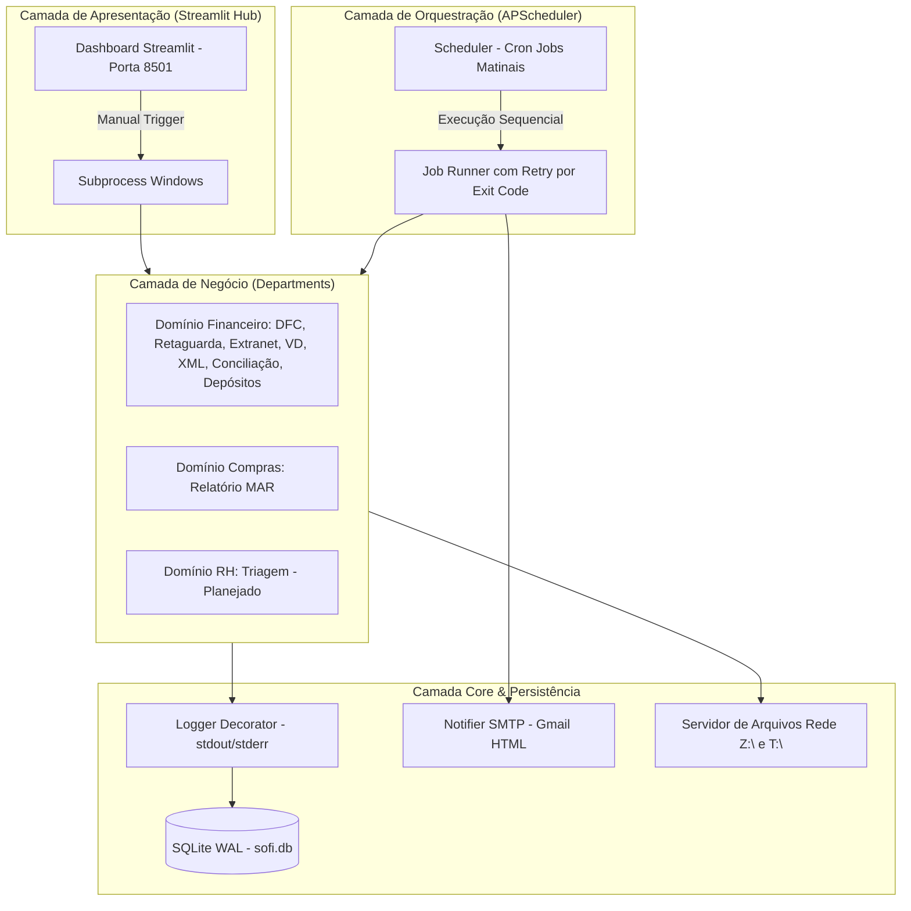

> **INSTRUÇÃO DE NAVEGAÇÃO PARA IA:** Este projeto possui uma base de conhecimento arquitetural em Obsidian. Wikilinks `[[nome]]` representam documentos relacionados. Ao encontrar um wikilink relevante para uma tarefa, utilize suas ferramentas de busca/leitura para localizar o documento correspondente dentro de `obsidian/` e leia seu conteúdo antes de modificar código relacionado. Não deduza informações arquiteturais quando houver documentação disponível.

---

# 🌐 Mapa Arquitetural do SOFI (Sistema Operacional Financeiro Integrado)

O **SOFI** é um **Hub Corporativo Autônomo** de automação operacional e financeira projetado sob medida para uma franqueada do **Grupo Boticário**, responsável pela gestão de **43 lojas (PDVs)** distribuídas entre as regiões operacionais de **Uberlândia (UDI)** e **Belo Horizonte (BH)**.

---

## 🎯 Objetivo do Sistema

O sistema resolve o gargalo crítico de tarefas repetitivas, manuais e descentralizadas que sobrecarregavam a equipe financeira:
- **Problema resolvido:** A equipe despendia entre 2h e 3h diárias acessando múltiplos portais (FinançasGB, Retaguarda, Extranet), realizando downloads, preenchendo planilhas, conciliando transações de cartões e lançando depósitos loja por loja.
- **Resultado obtido:** Redução do tempo operacional diário para aproximadamente **5 minutos**, automatizando mais de 80% das tarefas repetitivas, eliminando erros humanos de digitação e descentralizando o conhecimento em um ativo corporativo permanente e auditável.

---

## 🏗️ Arquitetura Conceitual

O SOFI opera em um servidor dedicado Windows Server 24/7 com uma arquitetura estritamente desacoplada em quatro camadas:

---

## 🏢 Domínios Identificados

O ecossistema divide-se conceitualmente nos seguintes domínios:

1. **[[dominio_financeiro]]** *(Fato — Em Produção)*: Centraliza todas as rotinas de extração de relatórios, processamento fiscal de fornecedores, monitoramento de e-mails de vendas diretas, conciliação de recebíveis e automação de depósitos.
2. **[[dominio_compras]]** *(Fato — Ativo)*: Engloba rotinas de extração e tratamento do Relatório MAR (compras de insumos e produtos), migrado para a estrutura do SOFI com interface gráfica dedicada.
3. **[[dominio_rh]]** *(Fato — Planejado / Placeholder)*: Estrutura reservada para triagem automatizada de candidatos e currículos via Inteligência Artificial.
4. **[[core_infraestrutura]]** *(Fato — Em Produção)*: Serviços transversais compartilhados que sustentam a governança, orquestração, logging, notificação e configuração do ecossistema.

---

## 🧩 Módulos Identificados

### Domínio Financeiro

- [[modulo_fluxo_analitico_dfc]]
  - **Objetivo:** Extração do relatório de Demonstração de Fluxo de Caixa (DFC) projetado para 12 meses.
  - **Responsabilidade:** Acessa o FinançasGB via Playwright para UDI e BH, aguarda o cálculo dinâmico e salva a planilha na rede corporativa em `Z:\FLUXO ANALÍTICO DIÁRIO\`.
  - **Regras críticas:** Horizonte de projeção de mês atual até mês atual + 12 meses; fallback para múltiplos seletores DOM do portal.

- [[modulo_extrator_retaguarda]]
  - **Objetivo:** Extração de relatórios diários de faturamento da Retaguarda e importação no FinançasGB.
  - **Responsabilidade:** Navega no portal Retaguarda via Playwright, seleciona as holdings regionais, extrai dados de D-1 e invoca o módulo de importação.
  - **Regras críticas:** Unificado para UDI e BH via parâmetro CLI `--unidade`; geração de XLS compatível com sistemas legados.

- [[modulo_extrator_extranet]]
  - **Objetivo:** Extração de relatórios de vendas consolidadas D-1 da Extranet Boticário.
  - **Responsabilidade:** Realiza login na Extranet com Playwright, baixa os relatórios CSV de vendas e despacha para upload no FinançasGB.
  - **Regras críticas:** Execução segregada por região (scripts independentes para BH e UDI); agendado diariamente às 09:00 e 09:15.

- [[modulo_monitor_emails_vd]]
  - **Objetivo:** Monitoramento autônomo contínuo de caixas de entrada de Venda Direta (VD).
  - **Responsabilidade:** Conecta-se via Outlook Desktop (COM/pywin32) a 6 caixas de e-mail (3 UDI + 3 BH), detecta novos e-mails, extrai anexos XLSX, converte para XLS e salva na rede `Z:\`.
  - **Regras críticas:** Não exclui e-mails; converte o arquivo para formato binário XLS compatível com importação pelo Oracle; logs segregados por regional.

- [[modulo_xml_meudanfe]]
  - **Objetivo:** Download automatizado de arquivos XML de NF-e a partir de chaves de acesso.
  - **Responsabilidade:** Lê planilhas com chaves de NF-e e realiza consultas à API MeuDanfe v2, salvando os XMLs autorizados para auditoria.
  - **Regras críticas:** Utilização obrigatória de API Key autorizada; gestão de quotas e retries em chamadas REST.

- [[modulo_conversor_xml_sefaz]]
  - **Objetivo:** Conversão de XMLs de padrão proprietário MeuDanfe para o padrão oficial SEFAZ.
  - **Responsabilidade:** Reestrutura recursivamente tags XML, reordenando blocos (`NFe` antes de `protNFe`), convertendo atributos em subelementos e injetando namespaces oficiais (schema `nfeProc v4.00`).
  - **Regras críticas:** O XML gerado deve passar rigorosamente na validação estrutural do Manual de Integração da NF-e sem falhas de schema.

- [[modulo_gerador_relatorio_calamo]]
  - **Objetivo:** Geração de relatórios analíticos formatados de notas fiscais da Cálamo Distribuidora.
  - **Responsabilidade:** Processa os XMLs convertidos e gera 4 planilhas Excel formatadas (Geral e Matheus, para BH e UDI) utilizando Microsoft Excel COM (`win32com.client.DispatchEx`).
  - **Regras críticas:** Aplicação de fórmulas Excel nativas (`VLOOKUP`, `SUMIFS`), cálculo de ICMS ST, regras de prazo por PDV (`regras_prazo.txt`) e estilo visual com linhas zebradas.

- [[modulo_extrator_retaguarda_xml]]
  - **Objetivo:** Extração do relatório base de notas fiscais de entrada da Cálamo no Portal Retaguarda.
  - **Responsabilidade:** Acessa o menu 'Compra -> Nota fiscal entrada' via Playwright, seleciona holdings e fornecedor Cálamo, filtra o intervalo semanal e baixa o XLS base.
  - **Regras críticas:** Manipulação de iframes legados (`legadoFrame`); agendamento de segunda a sexta às 07:00.

- [[modulo_extrator_picking]]
  - **Objetivo:** Extração e conciliação semanal de ordens de separação (OP Picking) por loja.
  - **Responsabilidade:** Lê os relatórios finais do Matheus, captura token Bearer na Extranet via Playwright, consulta a API de picking com rate-limit e gera planilhas individuais por PDV/nota.
  - **Regras críticas:** Rate-limit obrigatório com delay mínimo de 5s e jitter aleatório para evitar bloqueios de API.

- [[modulo_importar_financas]]
  - **Objetivo:** Serviço central de upload automatizado de arquivos no portal FinançasGB.
  - **Responsabilidade:** Recebe caminhos de arquivos, efetua login no FinançasGB com stealth anti-bot, fecha modais de onboarding/pesquisa e realiza o upload dos relatórios.
  - **Regras críticas:** Aplicação de `STEALTH_INIT_SCRIPT` para mascarar automação; desativação de recursos de automação visíveis; suporte a modo função e modo CLI interativo.

- [[modulo_conciliacao_vendas]]
  - **Objetivo:** Conciliação financeira automatizada de vendas por cartão e omnichannel no FinançasGB.
  - **Responsabilidade:** Lê planilhas de fechamento de caixa, interage via Selenium com a interface Knockout.js do FinançasGB e realiza o drag-and-drop físico entre Caixas Laranjas e Caixas Azuis.
  - **Regras críticas:** Casos 1-para-N possuem sistema de checkpoint com retomada; preenchimento automático de modais de justificativa; compilação em executável `.exe`.

- [[modulo_depositos]]
  - **Objetivo:** Automação de conferência e lançamento de depósitos identificados de lojas.
  - **Responsabilidade:** Captura tokens de sessão no FinançasGB via Playwright e executa requisições REST autenticadas para a API `FechamentoDeCaixaAPI/RealizarDeposito/`.
  - **Regras críticas:** Captura de Bearer/Cookies por login automatizado; validação cruzada entre foto de comprovante, relatório da Retaguarda e saldo em dinheiro.

### Domínio Compras

- [[modulo_relatorio_mar]]
  - **Objetivo:** Extração na Extranet e tratamento dos relatórios de compras MAR.
  - **Responsabilidade:** Automatiza o download dos dados brutos de compras na Extranet e processa planilhas consolidadas via scripts com interface gráfica em Tkinter.
  - **Regras críticas:** Possui build standalone via PyInstaller; regras de tratamento de datas e colunas específicas de pedidos de insumos.

### Domínio Recursos Humanos (RH)

- [[modulo_triagem_curriculos]] *(Classificação pendente)*
  - **Objetivo:** Triagem e classificação automatizada de candidatos e currículos via IA.
  - **Responsabilidade:** Previsto para receber currículos em massa e direcionar para vagas abertas.
  - **Regras críticas:** Não determinado pelo código/documentação disponível (em estágio de planejamento/placeholder).

### Core e Infraestrutura

- [[modulo_scheduler]]
  - **Objetivo:** Orquestração temporal autônoma de todos os jobs do sistema.
  - **Responsabilidade:** Inicializa o `BackgroundScheduler` com fuso `America/Sao_Paulo`, carrega jobs de `scheduler_config.json` e dispara subprocessos com retries automáticos.
  - **Regras críticas:** Singleton instanciado via `@st.cache_resource`; gestão de retry por exit codes (`0`, `1`, `2`, `3`); persistência de heartbeat em `scheduler_status.json`.

- [[modulo_notifier]]
  - **Objetivo:** Envio de resumos consolidados de execução via e-mail.
  - **Responsabilidade:** Conecta-se via SMTP Gmail (TLS) e despacha e-mail em formato HTML formatado com tabela de jobs, status, durações e tracebacks.
  - **Regras críticas:** Zero dependências externas (apenas `smtplib` e `email.mime`); disparo segregado por grupos de notificação (Retaguarda, XML, Extranet).

- [[modulo_logger_database]]
  - **Objetivo:** Auditoria e captura de logs de execução em banco de dados central.
  - **Responsabilidade:** Decorator `@log_execution` intercepta `stdout`/`stderr` gravando no SQLite em tempo real sem interferir no console.
  - **Regras críticas:** SQLite em modo WAL para leitura/escrita não-bloqueante; timeout de 10s.

- [[modulo_sofi_env]]
  - **Objetivo:** Gestão padronizada e hierárquica de variáveis de ambiente.
  - **Responsabilidade:** Carrega credenciais compartilhadas da raiz (`.env`) e permite sobrescrita departmental (`departments/<dept>/.env.local`).
  - **Regras críticas:** Isolamento de segredos fora do controle de versão Git.

- [[modulo_dashboard_hub]]
  - **Objetivo:** Ponto de entrada visual corporativo para gestores e operadores.
  - **Responsabilidade:** Interface web Streamlit com visual Sage, status em tempo real do scheduler, histórico de auditoria e botões de disparo manual.
  - **Regras críticas:** Desacoplamento de processos; execuções manuais são delegadas a novos consoles Windows via subprocess.

---

## 🔌 Integrações Externas Identificadas

1. **[[integracao_financasgb]]**: Portal financeiro do Grupo Boticário (`financasgb.grupoboticario.com.br`). Utilizado via Playwright (upload de faturamento, DFC) e chamadas de API REST direta (lançamento de depósitos).
2. **[[integracao_retaguarda]]**: Portal de backoffice de lojas (`cp10488.retaguarda.grupoboticario.com.br`). Acessado via Playwright com manipulação de frames legados para extração de receitas e notas de compra Cálamo.
3. **[[integracao_extranet]]**: Portal de franquias do Grupo Boticário (`extranet.grupoboticario.com.br`). Acessado via Playwright para extração de vendas D-1, relatórios MAR de compras e captura de Bearer tokens para picking.
4. **[[integracao_meudanfe]]**: API REST v2 (`meudanfe.com.br/api/v2`). Utilizada para consulta e download automatizado de XMLs de NF-e a partir de chaves de 44 dígitos.
5. **[[integracao_outlook_desktop]]**: Cliente Microsoft Outlook instalado no Windows Server. Acessado via COM/pywin32 para monitoramento contínuo de caixas postais sem intervenção humana.
6. **[[integracao_excel_desktop]]**: Microsoft Excel local. Instanciado via COM (`win32com.client.DispatchEx`) para renderização de fórmulas, formatações complexas e geração de planilhas formatadas Cálamo.
7. **[[integracao_sefaz]]**: Padrão fiscal estrutural oficial da Secretaria da Fazenda. O SOFI converte e valida XMLs contra o schema oficial `nfeProc v4.00`.
8. **[[integracao_rede_local]]**: Servidor de arquivos corporativo SMB (`\\srv-dc01\File Server\`), mapeado nas letras `Z:\` (Fechamento de Caixa) e `T:\13-Publica\` (Relatórios Cálamo e Picking).
9. **[[integracao_gmail_smtp]]**: Servidor de e-mail SMTP do Google (`smtp.gmail.com:587`). Utilizado para envio de alertas e relatórios consolidados em HTML.
10. **[[integracao_cloudflare_tunnel]]**: Conector de borda criptografado que viabiliza o acesso externo ao Dashboard Streamlit com segurança e sem abertura de portas no roteador da empresa.
11. **[[integracao_nssm_windows_service]]**: Gerenciador de serviços nativos do Windows que mantém o Streamlit e o Scheduler rodando continuamente em segundo plano.

---

## 🔀 Fluxos Principais Identificados

1. **[[fluxo_rotina_matinal_diaria]]**: Sequência orquestrada entre 07:00 e 09:30 disparada pelo Scheduler:
   - 07:00 → Extração DFC UDI e BH, Retaguarda UDI e BH, XML Entrada.
   - 09:00 e 09:15 → Extração Extranet BH e UDI seguida de upload automático no FinançasGB via `importar_financas.py`.
   - Ao término → Envio de e-mail consolidado com tabela de status via Notifier SMTP.
2. **[[fluxo_conferencia_calamo_semanal]]**:
   - Extração do relatório base na Retaguarda (`extrator_retaguarda_xml.py`).
   - Download de XMLs via API MeuDanfe (`debug_meudanfe.py`).
   - Conversão estrutural dos XMLs para padrão SEFAZ (`conversor_xml_sefaz.py`).
   - Geração de relatórios Excel auditados Geral e Matheus para BH e UDI via Excel COM (`gerador_relatorio.py`).
   - Extração semanal de OP Picking via Extranet API gerando planilhas por loja (`extrator_picking.py`).
3. **[[fluxo_monitoramento_emails_vd_continuo]]**:
   - Serviço em background (`iniciar_monitores_startup.vbs`) monitorando 6 caixas postais no Outlook.
   - Detecção de e-mail com anexo → Extração de XLSX → Conversão para XLS binário → Gravação na Rede `Z:\`.
4. **[[fluxo_conciliacao_fechamento_caixa]]**:
   - Leitura da planilha diária de fechamento de caixa na rede corporativa.
   - Triagem e agrupamento de pedidos (Omnichannel e Complexos 1-para-N).
   - Execução do robô Selenium para arrastar caixas e conciliar no FinançasGB com checkpoint de retomada.
5. **[[fluxo_lancamento_depositos_api]]**:
   - Captura de token Bearer no FinançasGB via Playwright (`capturar_token.py`).
   - Leitura de depósitos validados e execução de chamadas REST contra a API do portal.
6. **[[fluxo_extracao_compras_mar]]**:
   - Acesso à Extranet, download de relatórios de pedidos de compras de insumos e tratamento tabular para diretoria.

---

## ⚠️ Pontos Críticos e Vulnerabilidades

1. **Fragilidade a Alterações de Layout (DOM Breakage):** As automações baseadas em Playwright e Selenium dependem da estabilidade dos seletores de interface do Grupo Boticário (FinançasGB, Extranet, Retaguarda). Mudanças de layout ou novas telas de onboarding podem interromper extrações matinais.
2. **Dependência de Ambiente Windows Desktop (Host Lock-in):** Os módulos de Outlook (VD) e Excel (Cálamo) utilizam pontes COM binárias nativas do Windows (`win32com.client`), impedindo a migração direta do SOFI para containers Linux (Docker) sem refatoração dessas bibliotecas.
3. **Disponibilidade da Rede Local SMB (Z:\ e T:\):** Falhas transitórias no compartilhamento de arquivos `\\srv-dc01\` ou perda de mapeamento de letras no usuário de serviço do Windows interrompem o salvamento de relatórios e fechamentos de caixa.
4. **Concorrência no SQLite:** O uso do modo WAL minimiza conflitos, mas a ocorrência de múltiplos subprocessos simultâneos disparados com escrita massiva pode gerar contenção de lock se o timeout de 10s for superado.
5. **Gestão de Sessões e Tokens Expiráveis:** Módulos que operam via API REST (Depósitos e Picking) dependem de logins prévios via browser para captura de cookies e Bearer JWT temporários que expiram rapidamente.

---

## ❓ Pontos Ainda Não Determinados (Para Investigação Posterior)

1. **Fórmulas de Negócio do Relatório MAR:** *Não determinado pelo código disponível.* As regras de negócio exatas que orientam os cálculos de compras em `departments/compras/modules/relatorio_mar/tratamento_mar.py` carecem de validação com o departamento de Compras.
2. **Definição do Módulo de RH:** *Não determinado pelo código disponível.* A pasta `departments/rh/modules/triagem` possui apenas um arquivo `.gitkeep`; as fontes de currículos, regras de triagem e modelo de IA a ser utilizado ainda não estão especificados no repositório.
3. **Mapeamento Completo de Depósitos para as 43 Lojas:** O código de teste atual foca na loja 21061 (`mvp_deposito_21061.py`); a validação dos identificadores de todas as 43 lojas na planilha `lojas.xlsx` e as regras para depósitos divergentes precisam de homologação operacional.
4. **Gatilho de Execução do Extrator de Picking:** O arquivo `extrator_picking.py` está presente no repositório mas ainda não consta na grade de jobs do `scheduler_config.json`. Precisa ser determinado se ele deve rodar manualmente ou de forma agendada semanalmente.
