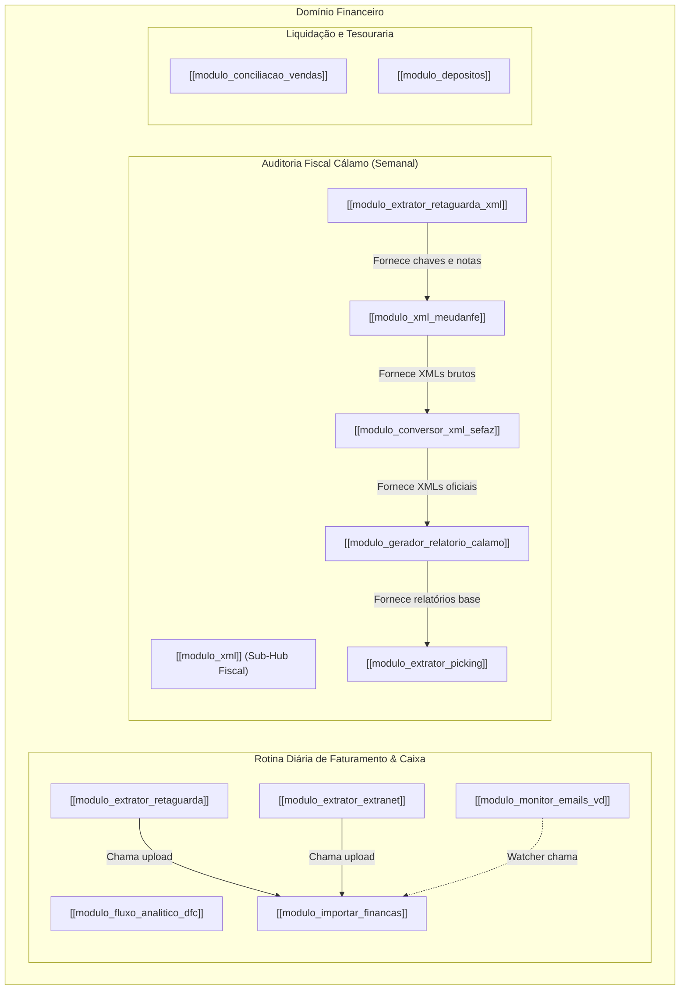
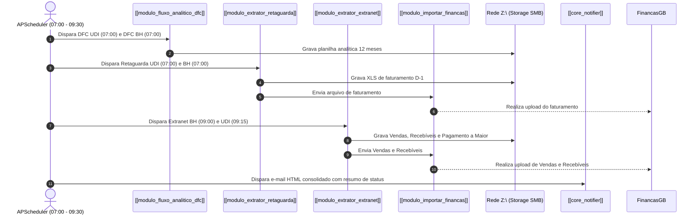
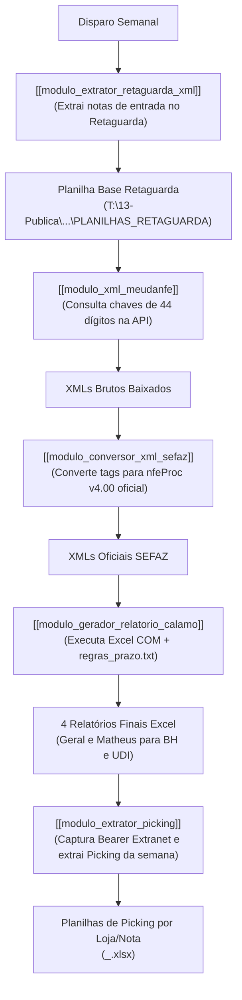

# 🏢 Domínio Financeiro (`departments/financeiro/`)

> **Classificação:** Domínio de Negócio Primário  
> **Status:** Ativo / Produção  
> **Abrangência:** 43 Lojas (PDVs) — Regionais Uberlândia (UDI) e Belo Horizonte (BH)  
> **Localização no Código:** `departments/financeiro/`  

---

## 🎯 Objetivo do Domínio

O **Domínio Financeiro** é o núcleo operacional e o maior ecossistema de automações do SOFI. Seu objetivo é centralizar, padronizar, conciliar e automatizar todas as tarefas operacionais de tesouraria, fluxo de caixa, conciliação de recebíveis e auditoria fiscal da franqueada do **Grupo Boticário**.

Historicamente, as rotinas exigiam que analistas e assistentes financeiros acessassem manualmente diversos portais proprietários, baixassem dezenas de planilhas diárias, realizassem conferências manuais de comprovantes e arrastassem transações em interfaces web. O SOFI atua como um operador autônomo sobre essas tarefas, garantindo rastreabilidade, padronização de nomenclatura na rede corporativa e redução drástica do tempo de fechamento.

---

## 🧩 Responsabilidades Principais do Setor

1. **Extração e Centralização de Faturamento:**
   - Coletar diariamente os relatórios de faturamento das lojas físicas na Retaguarda e Extranet do Grupo Boticário.
   - Salvar os arquivos na rede corporativa estruturada (`\\srv-dc01\File Server\05-FIN\`) com padrão rígido de datas (`ANO/MÊS/DIA`).
2. **Carga e Alimentação do Portal Financeiro:**
   - Realizar o upload automatizado dos relatórios extraídos diretamente no portal central **FinançasGB** via Playwright.
3. **Projeção e Gestão de Fluxo de Caixa:**
   - Extrair diariamente a Demonstração de Fluxo de Caixa (DFC) analítica com projeção de até 12 meses futuros para apoiar o comitê de diretoria.
4. **Monitoramento e Processamento de Venda Direta (VD):**
   - Escutar ativamente caixas postais do Microsoft Outlook para recepção de planilhas de fechamento de revendedoras, convertendo para formatos aceitos pelo ERP FinançasGB da franqueada.
1. **Auditoria Fiscal e Conferência de Fornecedores (Cálamo):**
   - Baixar XMLs de notas fiscais de compra da fornecedora Cálamo Distribuidora, normalizar sua estrutura contra o schema oficial da SEFAZ, auditar alíquotas de ICMS ST, verificar prazos de pagamento por loja e confrontar o faturamento contra as ordens de separação física (OP Picking).
6. **Conciliação Financeira de Cartões e Omnichannel:**
   - Confrontar as transações de venda dos PDVs contra os recebíveis das adquirentes (NSUs) no FinançasGB, aplicando baixa automática via drag-and-drop.
7. **Lançamento e Conferência de Depósitos Bancários:**
   - Automatizar o registro dos depósitos em dinheiro realizados pelos caixas das lojas diretamente na API interna do FinançasGB.

---

## 📦 Módulos Integrantes do Domínio

O domínio é composto por 12 módulos conceituais especializados:

---

### 1. [[modulo_fluxo_analitico_dfc]]
- **Objetivo:** Extração do relatório analítico de fluxo de caixa projetado a 12 meses no FinançasGB.
- **Responsabilidade:** Realiza login no portal para UDI e BH, navega até o menu de Fluxo de Caixa, marca checkboxes analíticos, preenche período de 12 meses dinâmicos e salva o Excel na rede.
- **Entradas:** Credenciais de portal (`FINANCAS_UDI_USER` / `FINANCAS_BH_USER`), data de referência via CLI (`--data`).
- **Saídas:** Arquivo `.xlsx` salvo em `\\srv-dc01\File Server\05-FIN\FLUXO ANALÍTICO DIÁRIO\<UNIDADE>\<ANO>\<MÊS>\<DIA>\`.
- **Código Relacionado:**
  - `departments/financeiro/modules/fluxo_caixa/extrator_dfc.py` (UDI)
  - `departments/financeiro/modules/fluxo_caixa/extrator_dfc_bh.py` (BH)
- **Regras Críticas:** Projeção temporal dinâmica via `relativedelta(months=12)`; fallback com múltiplos seletores CSS/XPath; disparado diariamente às 07:00.

### 2. [[modulo_extrator_retaguarda]]
- **Objetivo:** Extração dos relatórios diários de receitas de vendas e upload direto no FinançasGB.
- **Responsabilidade:** Acessa o portal Retaguarda via Playwright, seleciona as holdings regionais, exporta relatório em formato `.xls` e invoca o utilitário `importar_financas.py`.
- **Entradas:** `--unidade UDI|BH`, `--data` (D-1 por padrão), credenciais de Retaguarda.
- **Saídas:** Arquivo `.xls` legado em `\\srv-dc01\File Server\05-FIN\FECHAMENTO DE CAIXA\IMPORTAÇÃO FINANÇAS GB\<UNIDADE>\` e carga confirmada no FinançasGB.
- **Código Relacionado:**
  - `departments/financeiro/modules/retaguarda/extrator_retaguarda.py`
  - `departments/financeiro/modules/retaguarda/executar_relatorio.bat`
- **Regras Críticas:** Unificação de código UDI/BH por parâmetro CLI; conversão explícita para BIFF8 `.xls` via biblioteca `xlwt`.

### 3. [[modulo_extrator_extranet]]
- **Objetivo:** Extração de relatórios consolidados de vendas D-1 da Extranet Boticário.
- **Responsabilidade:** Autentica-se na Extranet com Playwright, seleciona lojas e gera 3 relatórios: Vendas (CSV), Recebíveis (CSV) e Pagamento a Maior (XLS). Despacha Vendas e Recebíveis para upload no FinançasGB.
- **Entradas:** Credenciais Extranet Boticário, códigos de lojas (`STORE_CODES`), data D-1.
- **Saídas:** Arquivos salvos na rede; upload de Vendas e Recebíveis no FinançasGB.
- **Código Relacionado:**
  - `departments/financeiro/modules/extranet/UDI/extranet_reports_udi.py`
  - `departments/financeiro/modules/extranet/BH/extranet_reports_bh.py`
- **Regras Críticas:** O relatório "Pagamento a Maior" é exclusivamente arquivado na rede e **NUNCA** deve ser importado no FinançasGB.

### 4. [[modulo_monitor_emails_vd]]
- **Objetivo:** Monitoramento autônomo contínuo de caixas postais de Venda Direta no Outlook.
- **Responsabilidade:** Conecta-se via COM ao Outlook Desktop em 6 caixas postais (3 UDI + 3 BH). Ao detectar e-mails de remetentes autorizados contendo anexos de controle de títulos, salva-os na rede, converte para `.xls` para integração com o Oracle e despacha upload no FinançasGB via folder watcher a cada 5 minutos.
- **Entradas:** E-mails recebidos no Outlook Desktop de remetentes cadastrados (ex: `assistentevd@udiboticario.com.br`, `faturamento.vd@attboticario.com.br`).
- **Saídas:** Planilhas `.xls` salvas na rede em `FECHAMENTO DE CAIXA\IMPORTAÇÃO FINANÇAS GB\<UNIDADE>\<ANO>\<MÊS>\<DIA>\` e upload no FinançasGB.
- **Código Relacionado:**
  - `departments/financeiro/modules/AUTOMAÇÃO EMAILS VD/monitor_emails_vd.py` (UDI)
  - `departments/financeiro/modules/AUTOMAÇÃO EMAILS VD/BH/monitor_emails_vd_BH.py` (BH)
  - `departments/financeiro/modules/AUTOMAÇÃO EMAILS VD/automacao_outlook_vd.py`
  - Scripts de inicialização: `iniciar_monitores_startup.vbs`, `iniciar_todos_monitores.bat`
- **Regras Críticas:** Preservação estrita dos e-mails no Outlook (nunca exclui); conversão obrigatória para `.xls` legado devido ao parser do ERP Oracle.

### 5. [[modulo_xml_meudanfe]]
- **Objetivo:** Download automatizado de arquivos XML de notas fiscais via API REST MeuDanfe v2.
- **Responsabilidade:** Lê planilhas com chaves de acesso de NF-e (44 dígitos), dispara requisições HTTP autenticadas e grava os XMLs brutos recebidos.
- **Entradas:** Chaves de acesso de 44 dígitos, variável `MEUDANFE_API_KEY`.
- **Saídas:** Arquivos `.xml` brutos salvos na rede `T:\13-Publica\XMLS CÁLAMO\XML BAIXADOS\`.
- **Código Relacionado:**
  - `departments/financeiro/modules/xml/debug_meudanfe.py`
- **Regras Críticas:** Controle de quotas e retries em caso de instabilidade na API externa.

### 6. [[modulo_conversor_xml_sefaz]]
- **Objetivo:** Adequação estrutural dos XMLs MeuDanfe para o padrão oficial SEFAZ (`nfeProc v4.00`).
- **Responsabilidade:** Reordena tags internas recursivamente (colocando bloco `NFe` antes de `protNFe`), transforma nós-atributos em subelementos e injeta os schemas oficiais de validação fiscal.
- **Entradas:** Diretório de arquivos XML brutos.
- **Saídas:** Arquivos XML estruturalmente idênticos ao padrão do Manual de Integração da NF-e da SEFAZ.
- **Código Relacionado:**
  - `departments/financeiro/modules/xml/conversor_xml_sefaz.py`
- **Regras Críticas:** Validação semantico-estrutural estrita para viabilizar a leitura posterior por bibliotecas padrão e ERP.

### 7. [[modulo_gerador_relatorio_calamo]]
- **Objetivo:** Geração de relatórios gerenciais e contábeis semanais de conferência de notas fiscais Cálamo.
- **Responsabilidade:** Analisa os XMLs convertidos, extrai bases de cálculo e alíquotas de ICMS ST, aplica regras de prazos por loja e instancia o Microsoft Excel via COM para preencher 4 planilhas formatadas com fórmulas nativas e totalizadores por canal.
- **Entradas:** Arquivos XML SEFAZ, planilha de modelo base, configuração de prazos (`regras_prazo.txt`).
- **Saídas:** 4 planilhas Excel `.xls`:
  1. `Relatorio_Final_Geral_BH.xls`
  2. `Relatorio_Final_Geral_UDI.xls`
  3. `Relatorio_Final_Matheus_BH.xls`
  4. `Relatorio_Final_Matheus_UDI.xls`
- **Código Relacionado:**
  - `departments/financeiro/modules/xml/gerador_relatorio.py`
  - `departments/financeiro/modules/xml/leitor_xml.py`
  - `departments/financeiro/modules/xml/read_xls.py`
  - `departments/financeiro/modules/xml/regras_prazo.txt`
- **Regras Críticas:** Instanciação isolada de Excel via `DispatchEx`; segregação de faturamento por canais (Loja, VD, Eudora); cálculo de prazos base conforme tabela configurável por PDV.

### 8. [[modulo_extrator_retaguarda_xml]]
- **Objetivo:** Extração do relatório base de notas fiscais de entrada emitidas pela Cálamo via Retaguarda.
- **Responsabilidade:** Navega no menu 'Compra -> Nota fiscal entrada' da Retaguarda via Playwright, acessa o iframe `legadoFrame`, marca as holdings e o fornecedor Cálamo, aplica a semana corrente e baixa o XLS consolidado.
- **Entradas:** Credenciais de Retaguarda, intervalo semanal (Segunda a Domingo).
- **Saídas:** Planilha base salva em `T:\13-Publica\XMLS CÁLAMO\PLANILHAS_RETAGUARDA\`.
- **Código Relacionado:**
  - `departments/financeiro/modules/xml/extrator_retaguarda_xml.py`
- **Regras Críticas:** Manipulação do iframe `legadoFrame`; execução agendada de segunda a sexta às 07:00.

### 9. [[modulo_extrator_picking]]
- **Objetivo:** Extração e conferência de Ordens de Separação (OP Picking) por nota fiscal.
- **Responsabilidade:** Localiza a última semana faturada nos relatórios do Matheus, captura token Bearer JWT na Extranet via Playwright, consulta a API de picking com rate-limit e gera planilhas individuais por PDV/nota.
- **Entradas:** Relatórios finais Matheus, credenciais da Extranet.
- **Saídas:** Planilhas `.xlsx` com dados de picking (`<PDV>_<Nº_DOC>.xlsx`) na pasta da semana.
- **Código Relacionado:**
  - `departments/financeiro/modules/xml/extrator_picking.py`
  - `departments/financeiro/modules/xml/op_piking.xlsx` (template)
- **Regras Críticas:** Delay obrigatório >= 5s com jitter aleatório para evitar bloqueios de taxa na API corporativa.

### 10. [[modulo_importar_financas]]
- **Objetivo:** Serviço centralizado de upload de relatórios no portal FinançasGB.
- **Responsabilidade:** Realiza login no portal com proteções anti-bot, fecha modais de onboarding/pesquisa, faz upload multipart dos relatórios e captura screenshots em caso de anomalia.
- **Entradas:** Lista de caminhos de arquivos (`arquivos`), identificador de praça (`unidade="UDI"|"BH"`).
- **Saídas:** Confirmação de upload no portal e logs de auditoria.
- **Código Relacionado:**
  - `departments/financeiro/modules/importar_financas.py`
- **Regras Críticas:** Injeção de `STEALTH_INIT_SCRIPT` (desativa `navigator.webdriver`); fechamento de modais dinâmicos (Maze/Zendesk/Onboarding); suporte a modo CLI e biblioteca importável.

### 11. [[modulo_conciliacao_vendas]]
- **Objetivo:** Robô RPA de conciliação financeira de vendas de cartões e omnichannel no FinançasGB.
- **Responsabilidade:** Lê planilhas de fechamento de caixa, filtra ruídos (pix, boletos), abre o Chrome via Selenium, localiza as Caixas Laranjas (vendas PDV) e Caixas Azuis (recebíveis adquirentes) e realiza o drag-and-drop físico via `ActionChains`, preenchendo justificativas automáticas.
- **Entradas:** Planilhas de fechamento de caixa corporativas.
- **Saídas:** Baixa efetuada no portal e checkpoint em `pedidos_conciliados.txt`.
- **Código Relacionado:**
  - `departments/financeiro/modules/conciliacao_venda/robo_conciliacao_omini.py` (CLI)
  - `departments/financeiro/modules/conciliacao_venda/robo_conciliacao_omini_gui.py` (GUI CustomTkinter)
  - `departments/financeiro/modules/conciliacao_venda/robo_conciliacao_oficial_complexos.py` (1-para-N com checkpoint)
  - `departments/financeiro/modules/conciliacao_venda/app_caixa.py`
  - `departments/financeiro/modules/conciliacao_venda/resumo_projeto.md`
- **Regras Críticas:** Uso estrito do Selenium devido à exigência do drag-and-drop físico sobre Knockout.js; preenchimento obrigatório da justificativa "OMINICHANEL CARTAO"; recuperação de falhas via checkpoint.

### 12. [[modulo_depositos]]
- **Objetivo:** Lançamento automatizado de depósitos bancários identificados no FinançasGB via API REST.
- **Responsabilidade:** Captura token de sessão e cookies via Playwright (`capturar_token.py`), monta o payload JSON com contas de origem/destino e dispara requisições POST para a API do portal.
- **Entradas:** Mapeamento de contas em `lojas.xlsx`, comprovantes de depósito, relatório de dinheiro da Retaguarda.
- **Saídas:** Lançamento de crédito efetuado no FinançasGB via endpoint HTTP.
- **Código Relacionado:**
  - `departments/financeiro/modules/depositos/AUTOMACOES DE DEPOSITO/script_depositos.py`
  - `departments/financeiro/modules/depositos/AUTOMACOES DE DEPOSITO/capturar_token.py`
  - `departments/financeiro/modules/depositos/AUTOMACOES DE DEPOSITO/mvp_deposito_21061.py`
  - `departments/financeiro/modules/depositos/AUTOMACOES DE DEPOSITO/lojas.xlsx`
- **Regras Críticas:** Endpoint `POST /FechamentoDeCaixaAPI/RealizarDeposito/`; validação prévia de saldo em espécie para evitar diferenças de caixa; captura dinâmica de sessão para contornar expiração de autenticação.

---

## 🔗 Dependências e Relações do Domínio

### Relação com a Camada Core (`core/`)
- **[[core_scheduler]]**: Orquestra os horários de disparo das rotinas matinais (07:00, 08:00, 08:15, 08:30, 08:45, 09:00, 09:15).
- **[[core_logger_database]]**: Todos os módulos utilizam `@log_execution` gravando em tempo real na tabela `execution_logs` do `sofi.db`.
- **[[core_sofi_env]]**: Todos os scripts invocam `load_sofi_env(department="financeiro")` para carregar credenciais do `.env` raiz e de eventuais arquivos `.env.local`.
- **[[core_notifier]]**: Notifica a equipe financeira consolidando os resultados de Retaguarda, XML e Extranet por e-mail via Gmail SMTP.

### Relação com outros Domínios
- **[[dominio_compras]]**: Compartilha o portal Extranet Boticário, porém opera sob isolamento estrito de código (sem imports cruzados).
- **[[dominio_rh]]**: Sem dependências operacionais diretas.

### Integrações Externas do Financeiro
- **[[integracao_financasgb]]**: Portal alvo para uploads de faturamento, conciliação e API de depósitos.
- **[[integracao_retaguarda]]**: Fonte de receitas de vendas e notas fiscais de compra.
- **[[integracao_extranet]]**: Fonte de relatórios de vendas D-1, relatórios de crédito e API de picking.
- **[[integracao_meudanfe]]**: API REST para download de XMLs.
- **[[integracao_outlook_desktop]]**: Interface COM local para captura contínua de e-mails de VD.
- **[[integracao_excel_desktop]]**: Interface COM local para renderização dos relatórios Cálamo.
- **[[integracao_rede_local]]**: Armazenamento central nas unidades de rede `Z:\` e `T:\`.

---

## 🔄 Principais Fluxos Operacionais do Financeiro

### Fluxo 1: Rotina Matinal de Fechamento Diário
Executado de forma autônoma de segunda a domingo pelo Scheduler:

### Fluxo 2: Ciclo Semanal de Auditoria Fiscal Cálamo
Executado semanalmente para conferência das notas de fornecimento das 43 lojas:

### Fluxo 3: Monitoramento Contínuo de E-mails VD
Executado 24/7 em background via serviço de inicialização Windows:
1. Listener COM ativo no Outlook monitora chegada de novas mensagens.
2. Identifica e-mails com assunto de unidades VD (UDI, ARI, JP em UDI; Itapoã, Venda Nova, ER Neves em BH).
3. Baixa o anexo `Controle de Títulos...xlsx`.
4. Converte internamente para `.xls` legado para compatibilidade com o FinançasGB.
5. Salva na pasta de rede da unidade correspondente.
6. A cada 300 segundos, o watcher detecta novos fechamentos e aciona `upload_para_financas()`.

### Fluxo 4: Conciliação Financeira de Cartões / Omnichannel
Executado diariamente pelos operadores (via interface gráfica ou console):
1. O robô lê a planilha diária de fechamento de caixa na rede corporativa.
2. Filtra as vendas com classificação Omnichannel e totaliza valores fracionados por pedido.
3. Abre o Chrome controlado via Selenium no FinançasGB.
4. Identifica no DOM as Caixas Laranjas (lado esquerdo) e Caixas Azuis (lado direito).
5. Executa `ActionChains.drag_and_drop()` arrastando a venda até seu NSU correspondente.
6. Se o portal abrir modal de justificativa, preenche "OMINICHANEL CARTAO" e confirma.
7. Registra os pedidos concluídos em `pedidos_conciliados.txt` (checkpoint para retomada caso o portal oscile).

---

## 🧠 Regras Gerais de Negócio do Domínio

### FATO 1: Segregação Regional Rígida (UDI vs BH)
As operações de Uberlândia (UDI) e Belo Horizonte (BH) são juridicamente e operacionalmente segregadas. Possuem credenciais distintas nos portais, diretórios separados na rede corporativa (`.../UDI/` e `.../BH/`), caixas de e-mail exclusivas e relatórios gerenciais independentes.

### FATO 2: Obrigatoriedade do Formato Legado `.xls` (BIFF8)
Embora bibliotecas modernas trabalhem nativamente com `.xlsx`, sistemas legados da franqueada (especialmente o ERP FinançasGB e rotinas internas legadas) exigem arquivos no formato binário `.xls`. Portanto, os módulos de Retaguarda e E-mails de VD geram ou convertem explicitamente para `.xls` utilizando `xlwt` ou automação via Excel COM.

### FATO 3: Política de Arquivamento vs Importação na Extranet
O extrator da Extranet gera 3 arquivos por execução:
- `Relatório de Vendas`: Importado automaticamente no FinançasGB.
- `Relatório de Recebíveis`: Importado automaticamente no FinançasGB.
- `Pagamento a Maior`: **NÃO** deve ser importado no portal, servindo exclusivamente como arquivo de conferência interna arquivado na rede.

### FATO 4: Prazos de Pagamento Customizados por PDV
A fornecedora Cálamo possui prazos base de pagamento negociados individualmente por unidade comercial:
- **Lojas Morumbi** (PDVs 21274, 22744, 17868, 21372, 23269, 19964): Dias base = `0` (regra `0+5+x`).
- **Lojas BH** (PDVs 13793, 22372, 21433): Dias base = `60` (regra `60+5+x`).
- **Lojas UDI VD** (PDVs 20844, 23275, 24417): Dias base = `45` (regra `45+5+x`).
- **Padrão Geral (DEFAULT):** Dias base = `30` (ou `45` conforme versão do arquivo `regras_prazo.txt`).

### FATO 5: Rate-Limit com Jitter na API de Picking
Consultas à API de picking da Extranet Boticário devem respeitar delay mínimo de 5 segundos acrescido de jitter randômico para simular comportamento humano e evitar bloqueios de taxa no firewall corporativo.

---

## ⚠️ Pontos Críticos e Vulnerabilidades do Domínio

1. **Acoplamento com a Interface Web dos Portais (DOM Volatility):**
   - FinançasGB, Extranet e Retaguarda sofrem alterações periódicas de classes CSS, estruturas de iframes e seletores. Qualquer mudança no frontend do Grupo Boticário pode quebrar a extração matinal.
2. **Dependência de Softwares Desktop Instalados no Servidor:**
   - O gerador de relatórios Cálamo depende da presença física do Microsoft Excel executando em segundo plano (`win32com.client.DispatchEx`), e o monitor de VD depende do Microsoft Outlook com perfis de e-mail autenticados. Travamentos dessas aplicações Windows podem bloquear os scripts.
3. **Mapeamento de Compartilhamentos de Rede SMB (`Z:\` e `T:\`):**
   - Todas as saídas são gravadas no servidor de arquivos `\\srv-dc01\File Server\`. Quedas de rede, instabilidades no Active Directory ou perda de mapeamento das unidades do usuário de serviço provocam falhas nos robôs.
4. **Captura e Validade Efêmera de Sessões (Tokens JWT):**
   - Os módulos de Depósitos e de Picking não utilizam login via API pública, mas capturam cookies e tokens Bearer de sessões de usuário simuladas via Playwright, que expiram em períodos curtos.

---

## 🔐 Segurança e Credenciais

- **Isolamento de Credenciais:** Nenhuma senha ou chave de API deve ser salva no código-fonte.
- **Hierarquia:** Lidas do `.env` central da raiz via `core.sofi_env`.
- **Principais Variáveis Consumidas pelo Financeiro:**
  - `FINANCAS_URL`, `FINANCAS_UDI_USER`, `FINANCAS_UDI_PASS`, `FINANCAS_BH_USER`, `FINANCAS_BH_PASS`
  - `RETAGUARDA_URL`, `RETAGUARDA_USER`, `RETAGUARDA_PASS`
  - `EXTRANET_USER`, `EXTRANET_PASSWORD`
  - `MEUDANFE_API_KEY`
  - `HEADLESS`, `BROWSER_CHANNEL`

---

## 🔎 Evidências e Referências de Código

- Diretório raiz do domínio: `departments/financeiro/`
- Módulos e scripts analisados:
  - `departments/financeiro/modules/fluxo_caixa/extrator_dfc.py`
  - `departments/financeiro/modules/fluxo_caixa/extrator_dfc_bh.py`
  - `departments/financeiro/modules/retaguarda/extrator_retaguarda.py`
  - `departments/financeiro/modules/extranet/UDI/extranet_reports_udi.py`
  - `departments/financeiro/modules/extranet/BH/extranet_reports_bh.py`
  - `departments/financeiro/modules/AUTOMAÇÃO EMAILS VD/monitor_emails_vd.py`
  - `departments/financeiro/modules/AUTOMAÇÃO EMAILS VD/BH/monitor_emails_vd_BH.py`
  - `departments/financeiro/modules/xml/gerador_relatorio.py`
  - `departments/financeiro/modules/xml/conversor_xml_sefaz.py`
  - `departments/financeiro/modules/xml/extrator_retaguarda_xml.py`
  - `departments/financeiro/modules/xml/extrator_picking.py`
  - `departments/financeiro/modules/xml/debug_meudanfe.py`
  - `departments/financeiro/modules/xml/regras_prazo.txt`
  - `departments/financeiro/modules/importar_financas.py`
  - `departments/financeiro/modules/conciliacao_venda/robo_conciliacao_omini.py`
  - `departments/financeiro/modules/conciliacao_venda/robo_conciliacao_omini_gui.py`
  - `departments/financeiro/modules/conciliacao_venda/robo_conciliacao_oficial_complexos.py`
  - `departments/financeiro/modules/depositos/AUTOMACOES DE DEPOSITO/script_depositos.py`
  - `departments/financeiro/modules/depositos/AUTOMACOES DE DEPOSITO/capturar_token.py`

---

## ❓ Pontos Não Determinados / Pendentes de Validação

1. **Inclusão do Picking no Scheduler:** *Não determinado pelo código disponível.* O script `extrator_picking.py` está pronto e testado, mas ainda não foi adicionado à grade oficial em `core/scheduler/scheduler_config.json`.
2. **Escala Completa da Automação de Depósitos:** A automação via API REST já possui o endpoint mapeado e o teste piloto realizado na loja 21061, mas a parametrização em escala para as outras 42 lojas ainda depende de validação dos IDs de contas na planilha `lojas.xlsx`.
3. **Disponibilização no Dashboard Web:** Os módulos de Conciliação de Vendas, Depósitos e E-mails VD operam atualmente via scripts de segundo plano ou executáveis locais, figurando com o badge "Em Breve" na interface Streamlit.

---

## 📊 Nível de Confiança

**Alta:** Todos os 12 módulos, suas entradas, saídas, dependências, bibliotecas e integrações foram verificados diretamente no código-fonte em execução no repositório.
