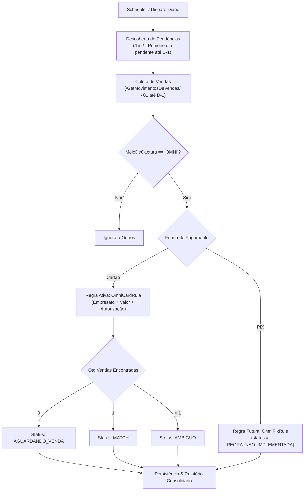

# 📦 modulo_conciliacao_omni

> **Classificação:** Módulo de Negócio / Domínio Financeiro  
> **Status:** Em Desenvolvimento (v1: REPORT_ONLY)  
> **Localização no Código:** `departments/financeiro/modules/conciliacao_omni/`  
> **Responsável:** SOFI Core — Domínio Financeiro  

---

## 🎯 Objetivo

Centralizar, automatizar e padronizar o processo de conciliação financeira de vendas omnichannel do Grupo Boticário originadas sob o meio de captura **OMNI**, confrontando as transações de recebíveis dos PDVs contra as movimentações de venda no ERP corporativo **FinançasGB**.

Na **v1**, o foco exclusivo é **OMNI Cartão** operando em modo estrito de auditoria (`REPORT_ONLY`), sem execução de baixa no endpoint `POST /Conciliar/`. Transações **OMNI PIX** são identificadas e segregadas de forma deliberada no estado `REGRA_NAO_IMPLEMENTADA` para preservação da fidelidade dos dados sem contaminação das regras de cartão.

---

## 🧩 Responsabilidades

1. **Descoberta de Pendências:**
   - Consultar o mapa de pendências no portal FinançasGB (`/List/`) desde o primeiro dia com OMNI pendente até `D-1`.
   - Gerenciar o cursor de processamento por dia e por loja (`processing_days`).
2. **Coleta de Movimentos de Venda:**
   - Extrair as movimentações de venda do mês corrente (`01 do mês até D-1`) via `/GetMovimentosDeVendas/`.
3. **Classificação e Segregação de Movimentos:**
   - Filtrar transações com `MeioDeCaptura = OMNI`.
   - Segregar por tipo de regra: `OMNI_CARD` para cartões e `OMNI_PIX` para pagamentos instantâneos.
4. **Motor de Regras Desacoplado (`ReconciliationRule`):**
   - Executar a regra `OmniCardRule` avaliando a chave composta `(EmpresaId, Valor, CodigoAutorizacao)`.
   - Marcar movimentos sem implementação ativa (`OmniPixRule`) como `REGRA_NAO_IMPLEMENTADA`.
5. **Relatórios e Auditoria:**
   - Registrar auditoria completa das correspondências (`MATCH`, `AGUARDANDO_VENDA`, `AMBIGUO`, `REGRA_NAO_IMPLEMENTADA`).
   - Apresentar consolidação diária discriminada por modalidade para a equipe financeira.

---

## 🔄 Fluxo de Processamento



---

## 🔗 Dependências

### Consome de
- [[dominio_financeiro]]: Diretrizes do negócio, segregação de lojas e credenciais corporativas.
- [[core_sofi_env]]: Carregamento seguro de credenciais via `load_sofi_env(department="financeiro")`.
- [[core_logger_database]]: Rastreabilidade e gravação de histórico com `@log_execution`.
- [[core_scheduler]]: Orquestração de disparos matinais em modo contínuo ou pontual.

### Fornece para
- Relatórios analíticos de conferência para a equipe financeira e tesouraria.
- Histórico persistido para futura automação de baixa ativa (`POST /Conciliar/` em fases posteriores).

### Integrações
- [[integracao_financasgb]]: Endpoints REST corporativos sob `https://financasgb.grupoboticario.com.br/ConciliacaoAPI/`:
  - `GET /ConciliacaoAPI/List/?data={data}&empresasIds={empresasIds}&firstDisplay=true` (Mapa de dias e status de pendências)
  - `GET /ConciliacaoAPI/GetMovimentosDeVendas/?de={de}&ate={ate}&empresasIds={empresasIds}` (Vendas corporativas do período 01 até D-1)
  - `GET /ConciliacaoAPI/GetConfirmacaoDoCartao/?data={data}&conciliado=false&empresasIds={empresasIds}&exibirMovimentosDeAjustes=false` (Movimentos de cartões/adquirentes pendentes)
  - `POST /ConciliacaoAPI/Conciliar/` (*desativado na v1 — apenas REPORT_ONLY*):
    ```json
    {
      "cartoes": ["id adquirente"],
      "ids": ["id venda"],
      "justificativa": "LANÇAMENTO COM CONCILIAÇÃO MANUAL DEVIDO INCONCISTENCIA DE DATA DE CREDITO NOVO PORTAL MOOZ CARTOES",
      "tipo": false,
      "errors": []
    }
    ```
- **Fluxo de Captura de Sessão / Cookie (Playwright):**
  1. Login no FinançasGB via credenciais centralizadas (`FINANCAS_UDI_USER` / `FINANCAS_UDI_PASS`).
  2. Navegação lateral até a tela de conciliação: seletor `//*[@id="mfe-sidebar-react"]/div/nav/div[2]/div[3]/a/p`.
  3. Aguardo do carregamento dos componentes do portal e clique no checkbox: `//*[@id="tabstrip-1"]/div[1]/div/label[2]/input`.
  4. Extração dos cookies de sessão do `BrowserContext` e token Bearer.
  5. Injeção dos headers de Cookie no cliente HTTP (`requests.Session`) para chamadas subsequentes.

---

## ⚙️ Código Relacionado

- `departments/financeiro/modules/conciliacao_omni/`
  - `client/financas_http.py` — Cliente HTTP autenticado contra a API do FinançasGB.
  - `domain/models.py` — Modelos de domínio, entidades e enumerações de estado.
  - `domain/rules/base.py` — Contrato abstrato `ReconciliationRule`.
  - `domain/rules/omni_card.py` — Regra concreta `OmniCardRule`.
  - `domain/rules/omni_pix.py` — Placeholder isolado `OmniPixRule`.
  - `storage/database.py` — Repositório SQLite para controle de cursor e auditoria.
  - `engine.py` — Orquestrador do motor de conciliação.
  - `report.py` — Gerador de relatórios tabulares e resumos operacionais.
  - `run_omni.py` — Ponto de entrada CLI e agendamento.

---

## 🧠 Regras de Negócio

### Regra 1: Segregação Arquitetural de Modalidades (Cartão vs PIX)
**Descrição:**  
Vendas OMNI com meio cartão seguem regras de liquidação e chaves de autorização estritas. PIX possui dinâmica temporal, prazos e identificadores distintos. O motor proíbe condicionais acumuladas (`if/else` genéricos) e adota instâncias especializadas de `ReconciliationRule`.  
**Status PIX na v1:** Classificado como `REGRA_NAO_IMPLEMENTADA` (nunca `SEM_CORRESPONDENCIA`, pois nenhuma regra foi executada).

### Regra 2: Matching de Cartão OMNI (v1)
**Critérios de Correspondência:**
1. `EmpresaId` idêntico (loja/PDV).
2. `Valor` líquido/bruto correspondente.
3. `CodigoDeAutorizacao` idêntico.

**Transições de Resultado:**
- **0 correspondências:** `AGUARDANDO_VENDA` (venda pode ser faturada ou transmitida com atraso).
- **1 correspondência exata:** `MATCH` (pronto para conferência e futura conciliação).
- **> 1 correspondências:** `AMBIGUO` (requer auditoria humana devido a duplicidade de valor/autorização).

### Regra 3: Janela Temporal e Gestão de Cursor
**Critérios:**
- **Vendas:** Intervalo contínuo do primeiro dia do mês corrente (`01`) até `D-1`.
- **Aquisições/Recebíveis:** Do primeiro dia com pendência detectada em `/List/` até `D-1`.
- O cursor de um dia permanece `PENDENTE_OMNI` enquanto houver qualquer movimento OMNI não resolvido.

### Regra 4: Modo Estrito de Auditoria (`REPORT_ONLY`)
**Descrição:**  
Na versão 1, o motor nunca dispara mutações contra o FinançasGB. O endpoint `POST /Conciliar/` é intencionalmente mockado ou desativado.

---

## 🚦 Máquina de Estados de Movimentos

| Estado | Significado | Próxima Ação |
| :--- | :--- | :--- |
| `NOVO` | Movimento ingerido da API, ainda não processado. | Submeter ao motor de regras. |
| `AGUARDANDO_VENDA` | OMNI Cartão avaliado, nenhuma venda correspondente encontrada até D-1. | Reprocessar na janela seguinte. |
| `MATCH` | Par único comprovado (EmpresaId + Valor + Autorização). | Consolidar no relatório v1 (candidato à conciliação futura). |
| `AMBIGUO` | Duas ou mais vendas atendem à mesma chave composta. | Alerta em relatório para intervenção manual. |
| `SEM_CORRESPONDENCIA`| Regra rodou e descartou esgotamento do ciclo (quando aplicável). | Arquivamento / Análise contábil. |
| `REGRA_NAO_IMPLEMENTADA` | Movimento identificado (ex: OMNI PIX), mas sem regra ativa na v1. | Manter isolado aguardando `OmniPixRule`. |
| `CONCILIADO` | Baixa efetivada via API (v2+). | Finalizado. |
| `ERRO` | Falha técnica de processamento ou divergência estrutural. | Log de erro / Retry. |

---

## ⚠️ Pontos Críticos e Riscos

1. **Instabilidade de Sessão no FinançasGB:** As chamadas REST dependem de Bearer Token e Cookies capturados via Playwright ou renovação de sessão.
2. **Duplicidade de Código de Autorização:** Transações com autorizações zeradas (`000000`) ou repetidas podem gerar falso positivo se não associadas ao `EmpresaId` e `Valor`.
3. **Delay de Integração Retaguarda x FinançasGB:** Vendas de D-1 podem demorar a subir no portal corporativo, gerando estado transitório de `AGUARDANDO_VENDA`.

---

## 🚨 Tratamento de Erros e Exit Codes

- `EXIT_OK (0)`: Execução e geração de relatório concluídas com sucesso.
- `EXIT_RETRYABLE (1)`: Oscilação de rede, timeout na API FinançasGB ou sessão expirada.
- `EXIT_PERMANENT (2)`: Erro de schema JSON, falha de validação ou erro de sintaxe.
- `EXIT_SEM_FATURAMENTO (3)`: Nenhum movimento OMNI pendente no período.

---

## 🔐 Segurança e Credenciais

Lidas exclusivamente via `core.sofi_env`:
- `FINANCAS_URL`
- `FINANCAS_UDI_USER` / `FINANCAS_UDI_PASS`
- `FINANCAS_BH_USER` / `FINANCAS_BH_PASS`
- Isolamento total de credenciais no `.env` da raiz corporativa.

---

## 📥 Entradas
- API `/List/` (dias com status de pendência).
- API `/GetMovimentosDeVendas/` (vendas corporativas).
- API `/GetConfirmacaoDoCartao/` (recebíveis e transações de cartões).

## 📤 Saídas
- Banco de dados SQLite (`processing_days`, `omni_movements`, `sales`, `matching_results`, `executions`).
- Relatório diário formatado (console, log estruturado e e-mail via `core_notifier`).

---

## 🗃️ Persistência e Logs
- Tabelas dedicadas no banco SQLite da aplicação.
- Logs estruturados decorados com `@log_execution(modulo="ConciliacaoOMNI")`.

---

## 📊 Nível de Confiança
**Alta:** Especificação formal alinhada com as diretrizes do projeto e plano v1 estabelecido.
