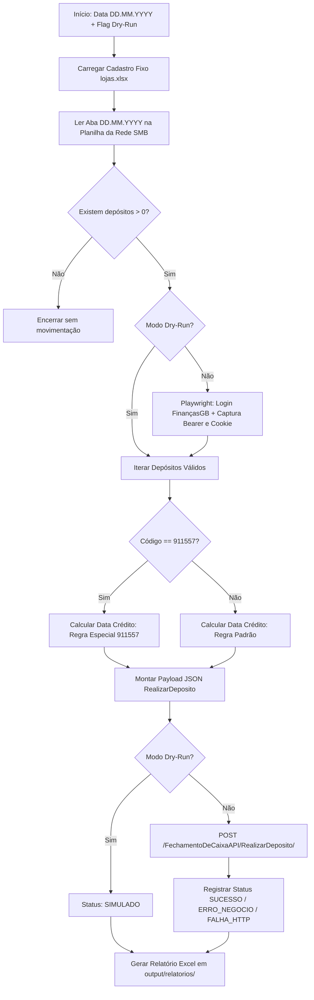

# 📦 modulo_depositos

> **Classificação:** Módulo de Negócio / Domínio Financeiro  
> **Status:** Em Produção (Escopo UDI — 22 Lojas) / Em Integração ao SOFI Hub  
> **Localização no Código:** `departments/financeiro/modules/depositos/`  
> **Responsável:** SOFI Core — Domínio Financeiro  

---

## 🎯 Objetivo

Automatizar a conferência e o lançamento em lote dos depósitos bancários em espécie realizados pelas lojas (PDVs e VD) diretamente na API interna do portal **FinançasGB** (`POST /FechamentoDeCaixaAPI/RealizarDeposito/`), eliminando o lançamento manual loja por loja.

---

## 🧩 Responsabilidades

1. **Leitura da Planilha de Fechamento na Rede:**
   - Acessar a planilha anual de acompanhamento de depósitos na rede corporativa (`\\srv-dc01\File Server\05-FIN\FECHAMENTO DE CAIXA\CONTROLE DE DEPÓSITO\UDI\2026\...`).
   - Localizar a aba correspondente à data de referência (`DD.MM.YYYY`) e extrair os depósitos válidos (`valor > 0`) da Tabela 1 (Uberlândia).
2. **Cruzamento Cadastral de Lojas (`lojas.xlsx`):**
   - Vincular o código numérico do PDV aos identificadores técnicos do FinançasGB (`CONTA_ORIGEM`, `CONTA_DESTINO`, `EMPRESA_ID`, `NOME_LOJA`).
3. **Cálculo Automático da Data de Crédito:**
   - Aplicar a regra padrão de compensação bancária para as lojas gerais e a regra especial para o PDV `911557` (QDB CSH).
4. **Captura Dinâmica de Sessão (Playwright):**
   - Autenticar no FinançasGB via `capturar_token.py`, navegar até o Fechamento de Caixa, forçar a geração de requisições autenticadas e extrair o `Bearer Token` e os `Cookies` de sessão do domínio `financasgb.grupoboticario.com.br`.
5. **Disparo REST e Relatório de Auditoria:**
   - Enviar cada depósito via HTTP POST para a API do FinançasGB (ou simular em modo `--dry-run`) e consolidar o resultado em planilha Excel de relatório.

---

## 🔄 Fluxo

---

## 🔗 Dependências

### Consome de
- [[dominio_financeiro]]: Regras operacionais de tesouraria e fechamento de caixa.
- [[modulo_sofi_env]]: Carregamento hierárquico de variáveis via `load_sofi_env(department="financeiro")`.
- [[modulo_logger_database]]: Registro de execução no SQLite (`sofi.db`) via `@log_execution`.

### Fornece para
- [[modulo_dashboard_hub]]: Exibição de logs de execução e disparo manual na interface Streamlit.
- Equipe Financeira: Relatórios em Excel de conferência dos lotes enviados (`output/relatorios/`).

### Integrações
- [[integracao_financasgb]]:
  - Login web via Playwright para captura de `Authorization: Bearer ...` e `Cookie`.
  - `POST https://financasgb.grupoboticario.com.br/FechamentoDeCaixaAPI/RealizarDeposito/`
  - `POST https://financasgb.grupoboticario.com.br/FechamentoDeCaixaAPI/ExcluirDeposito/?id={id_deposito}` (utilitário mapeado em `capturar_token.py`).
- [[integracao_rede_local]]:
  - Leitura da planilha `\\srv-dc01\File Server\05-FIN\FECHAMENTO DE CAIXA\CONTROLE DE DEPÓSITO\UDI\2026\05-FIN.FECHAMENTO DE CAIXA.CONTROLE DE DEPÓSITO.UDI.2026.PLANILHA DE ACOMPANHAMENTO DE DEPÓSITOS LOJAS - VD.xlsx`.

---

## ⚙️ Código relacionado

- `departments/financeiro/modules/depositos/script_depositos.py` — Script principal de processamento e lançamento em lote (`--data`, `--dry-run`, `--forcar-reenvio`).
- `departments/financeiro/modules/depositos/capturar_token.py` — Captura automatizada de Bearer Token e Cookies via Playwright.
- `departments/financeiro/modules/depositos/mvp_deposito_21061.py` — Script MVP individual interativo para a loja 21061 (CENTER SH).
- `departments/financeiro/modules/depositos/lojas.xlsx` — Cadastro das 22 lojas de UDI com `CODIGO_LOJA`, `NOME_LOJA`, `CONTA_ORIGEM`, `CONTA_DESTINO` e `EMPRESA_ID`.
- `dashboard/pages/depositos.py` — Interface web no Dashboard Streamlit para disparo manual (Simulação/Dry-Run ou Real), acompanhamento em tempo real e download do relatório.

---

## 🧠 Regras de negócio

### Regra 1: Cálculo de Data de Crédito — Regra Padrão (FATO)
**Descrição:**  
Os depósitos das lojas padrão são creditados conforme o dia da semana do depósito (`data_deposito.weekday()`):
- **Segunda-feira (0)** → Quarta-feira (`+2 dias`)
- **Terça-feira (1)** → Quarta-feira (`+1 dia`)
- **Quarta-feira (2)** → Sexta-feira (`+2 dias`)
- **Quinta-feira (3)** → Sexta-feira (`+1 dia`)
- **Sexta-feira (4)** → Segunda-feira (`+3 dias`)
- **Sábado (5)** → Segunda-feira (`+2 dias`)
- **Domingo (6)** → Segunda-feira (`+1 dia`)

**Implementação:** `calcular_credito_padrao()` em `script_depositos.py`.

### Regra 2: Cálculo de Data de Crédito — Regra Especial Loja 911557 (FATO)
**Descrição:**  
A loja `911557` (`QDB CSH`) possui janela diferenciada de compensação:
- **Segunda-feira (0)** → Quarta-feira (`+2 dias`)
- **Terça-feira (1)** → Sexta-feira (`+3 dias`)
- **Quarta-feira (2)** → Sexta-feira (`+2 dias`)
- **Quinta-feira (3)** → Segunda-feira seguinte (`+4 dias`)
- **Sexta-feira (4)** → Segunda-feira seguinte (`+3 dias`)
- **Sábado (5)** → Quarta-feira seguinte (`+4 dias`)
- **Domingo (6)** → Quarta-feira seguinte (`+3 dias`)

**Implementação:** `calcular_credito_911557()` em `script_depositos.py`.

### Regra 3: Formato do Payload e Datas na API (FATO)
**Descrição:**  
O endpoint `RealizarDeposito` exige datas no formato ISO UTC fixado em `03:00:00.000Z` (`%Y-%m-%dT03:00:00.000Z`), descrição padronizada `"Depósito para CC em DD/MM/YYYY"` e `NomeContaOrigem` formatado como `"CAIXA LOJA - {codigo} - {nome}"`.

### Regra 4: Controle de Idempotência / Duplicidade no SQLite (FATO)
**Descrição:**  
Para evitar lançamentos duplicados em execuções repetidas na mesma aba, cada depósito possui uma chave única `{codigo_loja}_{YYYY-MM-DD}_{valor:.2f}` gravada na tabela `depositos_lancados` do `sofi.db` após confirmação de `SUCESSO` na API. Reexecuções para o mesmo dia ignoram automaticamente lojas já lançadas (`Status = IGNORADO_DUPLICIDADE`), salvo quando acionado explicitamente `--forcar-reenvio`.

---

## ⚠️ Problemas conhecidos / gambiarras

1. **Delay intencional de 10s antes do clique em Entrar (`capturar_token.py`):**
   - Há um `time.sleep(10)` explícito após preencher e-mail/senha antes de clicar no botão de login para evitar bloqueio por CAPTCHA no portal FinançasGB.
2. **Abertura do Dropdown Kendo UI com 3 estratégias de fallback (`capturar_token.py`):**
   - O seletor de lojas no FinançasGB usa Kendo UI (`kendoDropDownList`), que frequentemente ignora o `.click()` padrão. O script tenta: (1) clicar no `span` original, (2) clicar na seta `span.k-select`, e (3) forçar abertura via `page.evaluate` chamando `.data('kendoDropDownList').open()`.
3. **Duplo clique forçado no calendário para geração de Cookies (`capturar_token.py`):**
   - Apenas logar no portal captura o header `Authorization: Bearer`, mas não popula todos os cookies de sessão do domínio `financasgb.grupoboticario.com.br`. O script seleciona a loja `20843` e dá `dblclick()` em um dia do `#calendarVendas` para forçar a requisição `ObterDepositosDoDia` e então extrai os cookies via `context.cookies()`.
4. **Leitura posicional da Planilha de Fechamento (`script_depositos.py`):**
   - A aba diária possui duas tabelas lado a lado (Tabela 1: Uberlândia nas colunas `0..8`; Tabela 2: RM-BH nas colunas `11..18`). O script atualmente lê `header=None` a partir do índice de linha `2` (linha 3 do Excel) fixando as colunas `1` (Código), `2` (Loja) e `6` (Depósito) — ou seja, processa exclusivamente a Tabela 1 (Uberlândia).
5. **Pausa de 1s entre requisições POST (`script_depositos.py`):**
   - Há um `time.sleep(1)` intencional entre cada lançamento na API para evitar sobrecarga/rate-limit no FinançasGB.

---

## 🚨 Tratamento de erros

- **Exit Codes SOFI:** `EXIT_OK (0)`, `EXIT_RETRYABLE (1)`, `EXIT_PERMANENT (2)`, `EXIT_SEM_FATURAMENTO (3)`.
- **Linhas inválidas ou zeradas:** Valores `<= 0`, vazios ou linhas de totalizador são silenciosamente ignorados na leitura da planilha.
- **Loja ausente em `lojas.xlsx`:** Não interrompe o lote; registra `Status = ERRO` no relatório final e prossegue para as próximas lojas.
- **Erros de API:** Classificados por loja como `SUCESSO` (HTTP 200/201 sem `errors`), `ERRO_NEGOCIO` (HTTP 200/201 com lista `errors` preenchida), `FALHA_HTTP` (outros status codes) ou `ERRO_REDE` (exceções de `requests`).

---

## 🔐 Segurança e Credenciais

- Variáveis carregadas via `load_sofi_env(department="financeiro")`:
  - `FINANCAS_URL`
  - `FINANCAS_UDI_USER`
  - `FINANCAS_UDI_PASS`
  - `DEPOSITOS_API_URL` (opcional, fallback para `https://financasgb.grupoboticario.com.br/FechamentoDeCaixaAPI/RealizarDeposito/`)
  - `DEPOSITOS_PLANILHA_UDI_PATH` (opcional, fallback dinâmico por ano em `\\srv-dc01\File Server\05-FIN\FECHAMENTO DE CAIXA\CONTROLE DE DEPÓSITO\UDI\<ANO>\...`)
- O `Bearer Token` e o `Cookie` são mantidos apenas em memória durante a execução e truncados no log de console.

---

## 📥 Entradas

- Parâmetro `--data` (`DD.MM.YYYY` ou `DD/MM/YYYY`), `--dry-run` e `--forcar-reenvio`.
- Planilha de rede: `05-FIN.FECHAMENTO DE CAIXA.CONTROLE DE DEPÓSITO.UDI.<ANO>.PLANILHA DE ACOMPANHAMENTO DE DEPÓSITOS LOJAS - VD.xlsx`.
- Cadastro local: `lojas.xlsx` (22 lojas UDI).

---

## 📤 Saídas

- Lançamentos registrados via API REST no FinançasGB.
- Planilha de relatório de execução: `output/relatorios/relatorio_depositos_<DD.MM.YYYY>_<HHMMSS>.xlsx`.

---

## 🗃️ Persistência e Logs

- `script_depositos.py` utiliza `@log_execution(modulo="Depósitos UDI")` gravando logs em tempo real em `execution_logs` no `sofi.db`.
- Depósitos confirmados com `SUCESSO` são persistidos na tabela `depositos_lancados` do `sofi.db` para bloqueio de duplicidade.
- Relatórios `.xlsx` são gerados em `departments/financeiro/modules/depositos/output/relatorios/`.

---

## 🔎 Evidências

Arquivos analisados:
- `departments/financeiro/modules/depositos/script_depositos.py`
- `departments/financeiro/modules/depositos/capturar_token.py`
- `departments/financeiro/modules/depositos/mvp_deposito_21061.py`
- `departments/financeiro/modules/depositos/lojas.xlsx`
- `dashboard/pages/depositos.py`
- `tests/financeiro/test_depositos.py`

---

## ❓ Pontos não determinados

1. **Suporte à Regional BH (Tabela 2 da planilha):** *Não determinado pelo código disponível.* A planilha da rede contém uma segunda tabela ao lado direito (`RM - BH` nas colunas 11 a 18), mas `lojas.xlsx` e `script_depositos.py` contemplam atualmente as 22 lojas de Uberlândia (`UDI`).

---

## 📊 Confiança

**Alta** — Documentação extraída diretamente do código-fonte e validada por testes automatizados.
