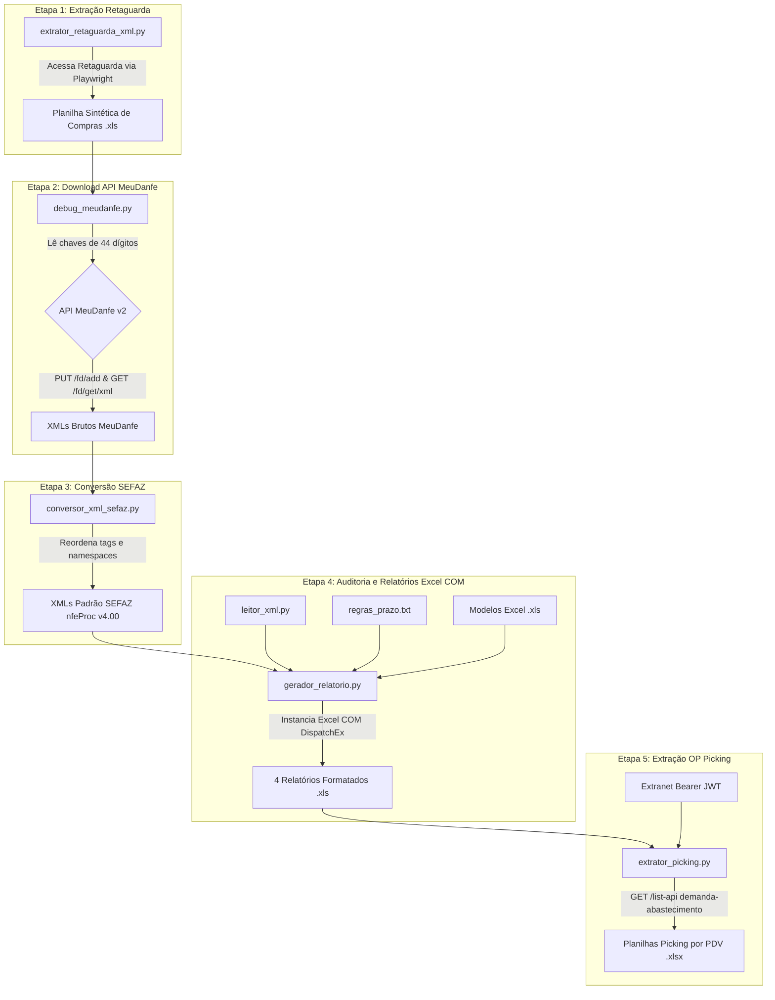

# 📦 Módulo XML — Auditoria Fiscal e Conferência Cálamo

> **Domínio:** [[dominio_financeiro]]  
> **Status:** Ativo / Produção  
> **Tipo:** Pipeline Fiscal, ETL e Automação Desktop/Web  
> **Localização no Código:** `departments/financeiro/modules/xml/`  
> **Confiança:** Alta  

---

## 🎯 Objetivo

O **Módulo XML** é o subsistema de inteligência e auditoria fiscal do SOFI responsável por coletar, normalizar, auditar e conciliar todas as Notas Fiscais Eletrônicas (NF-e) de compra emitidas pela principal fornecedora da franquia — a **Cálamo Distribuidora de Produtos de Beleza** — para as **43 lojas (PDVs)** das regiões de **Uberlândia (UDI)** e **Belo Horizonte (BH)**.

O módulo resolve o gargalo de conferência fiscal semanal:
- **Problema resolvido:** Antes do módulo, a conferência de centenas de notas de compra envolvia acessar portais, consultar chaves individualmente, auditar manualmente alíquotas de ICMS Substituição Tributária (ICMS ST), checar prazos de pagamento contratados por loja e confrontar o faturamento contra o que foi fisicamente separado no centro de distribuição.
- **Solução implementada:** Um pipeline automatizado que extrai as notas no portal Retaguarda, baixa os XMLs via API MeuDanfe v2, converte os arquivos para o padrão canônico da SEFAZ (`nfeProc v4.00`), extrai os metadados fiscais, aplica regras de prazo por PDV e gera relatórios executivos formatados via Microsoft Excel COM, além de extrair as Ordens de Separação (OP Picking) via API da Extranet.

---

## 🧩 Responsabilidades

1. **Extração da Relação de Compras (Retaguarda):**
   - Acessar o portal Retaguarda com Playwright, navegar até 'Compra -> Nota fiscal entrada', filtrar as holdings regionais e a fornecedora Cálamo e baixar a planilha sintética semanal.
2. **Download Massivo de XMLs (MeuDanfe API v2):**
   - Ler as chaves de acesso de 44 dígitos da planilha sintética e consultar a API REST MeuDanfe v2, adicionando as notas à conta corporativa e baixando os XMLs autorizados.
3. **Conversão e Normalização Fiscal SEFAZ:**
   - Normalizar os XMLs recebidos da API (que possuem nós fora de ordem e tags invertidas) para o padrão estrutural oficial exigido pelo Manual de Integração da NF-e v4.00 da SEFAZ.
4. **Extração e Parsing de Dados Fiscais:**
   - Extrair número do documento (`nNF`), data de emissão (`dhEmi`), vencimento (`dVenc`), valor dos produtos (`vProd`), valor total (`vNF`), base e valor de ICMS ST (`vBCST`, `vST`), CNPJ destinatário e número do pedido do cliente (`infCpl`).
5. **Mapeamento Dinâmico de Lojas e PDVs:**
   - Cruzar os CNPJs dos destinatários com a aba `NOMECLATURA LOJAS` das planilhas modelo, identificando automaticamente Loja, PDV, Unidade (BH ou UDI) e Canal comercial (Loja, VD ou Eudora).
6. **Aplicação de Prazos de Pagamento Customizados:**
   - Ler a tabela `regras_prazo.txt` e computar a data de vencimento e o prazo base de pagamento conforme a negociação de cada PDV (Morumbi: 0 dias; BH: 60 dias; UDI VD: 45 dias; Geral: 30/45 dias).
7. **Geração Automatizada de Relatórios Excel COM:**
   - Instanciar o Microsoft Excel em modo isolado (`DispatchEx`) para alimentar 4 relatórios formatados com fórmulas nativas (`VLOOKUP`, `SUMIFS`), formatação condicional zebrada e totalizadores segregados por canal.
8. **Extração de Ordens de Separação (OP Picking):**
   - Ler os relatórios de auditoria gerados, efetuar login na Extranet para capturar token Bearer JWT e consultar a API de demanda/abastecimento com rate-limiting, gerando planilhas de picking individuais por PDV/nota.

---

## 🔄 Fluxo Operacional (Pipeline em 5 Etapas)

### Detalhamento das Etapas:
1. **Etapa 1 — Extração Base:** `extrator_retaguarda_xml.py` conecta-se à Retaguarda, acessa o iframe `legadoFrame`, seleciona "BH LOJAS", "BH VD", "UDI LOJAS", "UDI VD", marca o fornecedor Cálamo, define o período de Segunda a Domingo e baixa a planilha sintética para `T:\13-Publica\XMLS CÁLAMO\PLANILHAS_RETAGUARDA\`.
2. **Etapa 2 — Download dos XMLs:** `debug_meudanfe.py` localiza a planilha mais recente na rede, extrai as chaves da coluna H (índice 7), valida os 44 dígitos numéricos, adiciona as notas na API MeuDanfe (`PUT /fd/add/{chave}`) e baixa o arquivo XML (`GET /fd/get/xml/{chave}`) respeitando rate-limit de 0.6s entre chamadas.
3. **Etapa 3 — Normalização Estrutural:** `conversor_xml_sefaz.py` varre a pasta de downloads temporários, inverte a ordem dos nós (`NFe` antes de `protNFe`), move atributos como `nItem` e `Id` para propriedades reais do elemento XML e reordena todos os filhos recursivamente conforme a lista canônica do Manual de Integração NF-e v4.00.
4. **Etapa 4 — Compilação dos Relatórios:** `gerador_relatorio.py` utiliza `leitor_xml.py` para extrair os metadados dos XMLs oficiais, cruza os CNPJs com `modelos_xmls/MODELO BH.xls` e `MODELO UDI.xls`, aplica os prazos de `regras_prazo.txt` e preenche a aba `Base` e a aba `Notas Fiscais` de 4 pastas de trabalho Excel via COM.
5. **Etapa 5 — Picking e Fechamento:** `extrator_picking.py` lê os relatórios do Matheus gerados, efetua login na Extranet, intercepta o Bearer JWT e consulta o endpoint de demanda para cada nota/PDV faturada, gerando planilhas `.xlsx` individuais baseadas no layout de `op_piking.xlsx`.

---

## 🔗 Dependências

### Consome de
- `[[core_sofi_env]]`: Carregamento centralizado de variáveis de ambiente.
- `[[core_logger_database]]`: Registro de logs de auditoria via decorator `@log_execution`.
- `[[core_scheduler]]`: Disparo agendado do `extrator_retaguarda_xml.py` de segunda a sexta-feira às 07:00.
- Modelos em `departments/financeiro/modules/xml/modelos_xmls/`:
  - `MODELO BH.xls` e `MODELO UDI.xls` (contêm aba `NOMECLATURA LOJAS`).
  - `MODELO_MATHEUS_BH.xls` e `MODELO_MATHEUS_UDI.xls`.
- Template de Picking: `op_piking.xlsx`.
- Tabela de regras: `regras_prazo.txt`.

### Fornece para
- `[[modulo_dashboard_hub]]`: Executável pela página web `/xml`, permitindo disparo de processo completo ou apenas geração de relatórios.
- Setor de Contabilidade / Controladoria: Planilhas auditadas na rede `T:\13-Publica\XMLS CÁLAMO\RELATÓRIOS COMPLETOS\<ANO>\<MÊS>\<SEMANA>\`.
- Gerentes de Loja e Depósito: Arquivos XML SEFAZ organizados por PDV em `T:\13-Publica\XMLS CÁLAMO\XML BAIXADOS\<ANO>\<MÊS>\<SEMANA>\<PDV>\`.

### Integrações
- `[[integracao_retaguarda]]`: Extração da relação base de compras via Playwright.
- `[[integracao_meudanfe]]`: API REST v2 para busca e download de XMLs.
- `[[integracao_sefaz]]`: Schema e leiaute oficial `nfeProc v4.00`.
- `[[integracao_excel_desktop]]`: Microsoft Excel nativo via automação COM (`win32com.client.DispatchEx`).
- `[[integracao_extranet]]`: Portal e API de Demanda/Abastecimento para Ordens de Separação (Picking).
- `[[integracao_rede_local]]`: Unidade mapeada `T:\13-Publica\` e fallback local.

---

## ⚙️ Código Relacionado

| Arquivo | Papel / Responsabilidade Principal |
| :--- | :--- |
| `departments/financeiro/modules/xml/debug_meudanfe.py` | Leitor de planilhas sintéticas, consulta e download na API MeuDanfe v2. |
| `departments/financeiro/modules/xml/conversor_xml_sefaz.py` | Parser recursivo com `lxml` que converte XML MeuDanfe para padrão canônico SEFAZ. |
| `departments/financeiro/modules/xml/gerador_relatorio.py` | Motor de geração dos 4 relatórios formatados em Excel via automação COM. |
| `departments/financeiro/modules/xml/leitor_xml.py` | Parser de XMLs fiscais e mapeador dinâmico de lojas por CNPJ. |
| `departments/financeiro/modules/xml/read_xls.py` | Utilitário complementar para leitura de planilhas legadas em formato `.xls`. |
| `departments/financeiro/modules/xml/extrator_retaguarda_xml.py` | Robô Playwright para extração do relatório base de compras na Retaguarda. |
| `departments/financeiro/modules/xml/extrator_picking.py` | Robô Playwright e cliente REST para extração de OP Picking na Extranet. |
| `departments/financeiro/modules/xml/regras_prazo.txt` | Arquivo de configuração de prazos de pagamento base por PDV. |
| `departments/financeiro/modules/xml/op_piking.xlsx` | Template de referência para a geração das planilhas de separação de mercadorias. |

---

## 🧠 Regras de Negócio

### Regra: Identificação da Emitente Cálamo pela Raiz do CNPJ
- **Descrição:** Apenas notas fiscais emitidas pela Cálamo Distribuidora de Produtos de Beleza devem ser auditadas neste pipeline. A identificação é realizada checando se o CNPJ do emitente (`<emit><CNPJ>`) inicia com a raiz `06147451`.
- **Quando se aplica:** Durante a varredura e extração de XMLs.
- **Implementação:** `departments/financeiro/modules/xml/leitor_xml.py` (`RAIZ_CNPJ_EMITENTE_FILTRO = '06147451'` e função `eh_emitido_por_calamo()`).
- **Impacto:** Impede o processamento acidental de notas fiscais de outros fornecedores ou despesas gerais.

### Regra: Prazos de Pagamento Customizados por Loja (Dias Base)
- **Descrição:** O prazo de vencimento financeiro das notas da Cálamo é estruturado sob a fórmula `DiasBase + 5 + x`. Os dias base variam conforme acordo comercial por grupo de PDVs:
  - **Lojas Morumbi** (PDVs `21274`, `22744`, `17868`, `21372`, `23269`, `19964`): `DiasBase = 0`.
  - **Lojas BH** (PDVs `13793`, `22372`, `21433`): `DiasBase = 60`.
  - **Lojas UDI VD** (PDVs `20844`, `23275`, `24417`): `DiasBase = 45`.
  - **Demais Lojas (DEFAULT):** `DiasBase = 30` (ou `45` conforme versão do arquivo).
- **Quando se aplica:** No cálculo do detalhe de prazo na coluna J da aba Notas Fiscais dos relatórios.
- **Implementação:** `departments/financeiro/modules/xml/regras_prazo.txt` e função `carregar_regras_prazo()` em `gerador_relatorio.py`.
- **Impacto:** Alterações nessa regra modificam diretamente o fluxo de contas a pagar e o agendamento de liquidações financeiras da franqueada.

### Regra: Normalização Estrutural Obrigatória SEFAZ (`nfeProc v4.00`)
- **Descrição:** A API MeuDanfe retorna o XML da NF-e com o nó `<protNFe>` antes de `<NFe>`, com atributos como subelementos (ex: `<nItem>1</nItem>` em vez de `<det nItem="1">`) e elementos fora da sequência do schema fiscal. O conversor deve reordenar todos os elementos recursivamente segundo o Manual da NF-e e injetar os namespaces `http://www.portalfiscal.inf.br/nfe`.
- **Quando se aplica:** Imediatamente após o download e antes de qualquer extração fiscal ou arquivamento.
- **Implementação:** `departments/financeiro/modules/xml/conversor_xml_sefaz.py` (`ORDENS_SEFAZ` e função `converter_pasta()`).
- **Impacto:** Permite que qualquer validador oficial ou biblioteca padrão de mercado leia o XML sem acusar erro de schema XML.

### Regra: Extração do Pedido de Compra do Campo de Informações Complementares
- **Descrição:** O número oficial do pedido de compra ("Nosso Pedido") não vem nas tags padrão de pedido (`<xPed>`), mas sim concatenado no texto livre de informações complementares do contribuinte (`<infCpl>`), sob o padrão textual `Remessa.: <NUMERO_DO_PEDIDO>/...`.
- **Quando se aplica:** Durante a extração dos dados fiscais de cada XML.
- **Implementação:** `departments/financeiro/modules/xml/leitor_xml.py` (`re.search(r'Remessa\.:\s*([^/]+)', infCpl.text)`).
- **Impacto:** Fundamental para que o módulo de picking (`extrator_picking.py`) localize os itens faturados na API da Extranet.

### Regra: Correção de Inversão de Data de Vencimento (Dia/Mês)
- **Descrição:** Em notas emitidas no início do mês (dias 01 a 12), ocorrem casos em que a data de vencimento (`dVenc`) no XML é invertida no padrão americano (MM/DD/AAAA em vez de DD/MM/AAAA). O leitor valida se a data de vencimento aparente seria anterior à data de emissão; se for, os campos de dia e mês são invertidos para restabelecer a cronologia fiscal correta.
- **Quando se aplica:** Em `extrair_dados_xml()` quando `dt_emissao` e `dt_vencimento` são detectadas.
- **Implementação:** `departments/financeiro/modules/xml/leitor_xml.py` (linhas 218–235).
- **Impacto:** Evita inconsistências de vencimento negativo nos relatórios financeiros.

### Regra: Acúmulo Incremental Semanal sem Sobrescrita
- **Descrição:** As notas fiscais da semana são faturadas pela fornecedora ao longo de múltiplos dias. O gerador lê as notas já existentes no relatório final daquela semana (`carregar_notas_existentes_semana()`) antes de adicionar as novas notas, evitando perda de registros faturados no início da semana.
- **Quando se aplica:** Na execução diária do `gerador_relatorio.py`.
- **Implementação:** `departments/financeiro/modules/xml/gerador_relatorio.py` (linhas 142–232).
- **Impacto:** Garante que o relatório consolidado de sexta-feira contenha 100% dos faturamentos de segunda a sexta.

### Regra: Rate-Limit com Jitter na API de Picking
- **Descrição:** Requisições automatizadas à API de separação (`list-api.prd.demanda-abastecimento`) devem respeitar um intervalo mínimo de 5 segundos acrescido de jitter aleatório (`time.sleep(5 + random.uniform(0.5, 2.0))`) entre chamadas de notas.
- **Quando se aplica:** Na iteração de pedidos em `extrator_picking.py`.
- **Implementação:** `departments/financeiro/modules/xml/extrator_picking.py`.
- **Impacto:** Evita bloqueios por WAF/Rate Limiting no gateway de APIs corporativas do Grupo Boticário.

---

## ⚠️ Pontos Críticos

1. **Instâncias Órfãs do Microsoft Excel no Servidor:**
   - O gerador manipula planilhas via `win32com.client.DispatchEx('Excel.Application')`. Se o script for interrompido bruscamente ou lançar exceção fora do bloco de fechamento, processos `EXCEL.EXE` continuam ativos em segundo plano, travando arquivos com lock de edição.
2. **Quota e Estabilidade da API MeuDanfe:**
   - O download dos XMLs depende de conexão externa com a API MeuDanfe v2. Instabilidade na API de terceiros ou chave de API inválida/expirada interrompe o download e a geração dos relatórios.
3. **Mapeamento e Disponibilidade da Unidade de Rede `T:\`:**
   - Todos os arquivos intermediários e finais residem em `T:\13-Publica\XMLS CÁLAMO\`. Se o mapeamento de rede SMB cair no servidor Windows, o sistema é obrigado a operar em fallback local, gerando descentralização dos arquivos.
4. **Dependência do reCAPTCHA v3 no Login da Retaguarda:**
   - O portal Retaguarda utiliza reCAPTCHA v3. O script `extrator_retaguarda_xml.py` implementa recarga completa da página e esperas progressivas de até 25 segundos para evitar bloqueios de "Não autorizado".

---

## 🚨 Tratamento de Erros e Resiliência

- **Retries na API MeuDanfe:** Máximo de 3 tentativas para adicionar a nota (`PUT /fd/add/{chave}`) e 3 tentativas para baixar o XML (`GET /fd/get/xml/{chave}`), com intervalo de 2s e timeout de 120s por requisição.
- **Polling de Status de Processamento:** Aguarda até 30 segundos com checagem a cada 2s para que notas com status `WAITING` passem para `SEARCHING` e `OK` no MeuDanfe.
- **Fallback de Armazenamento:** Caso o caminho de rede `T:\13-Publica\...` não esteja disponível, os scripts redirecionam automaticamente as saídas para pastas locais (`downloads_retaguarda/` ou `xmls_meudanfe/`).
- **Limpeza de Instâncias COM:** Uso de blocos `try ... finally` garantindo que `wb.Close(SaveChanges=False)` e `excel.Quit()` sejam chamados mesmo em falhas graves de execução.

---

## 🔐 Segurança e Credenciais

- **Credenciais Consumidas:**
  - `MEUDANFE_API_KEY`: Chave de autenticação da API de XMLs (cabeçalho `api-key`).
  - `RETAGUARDA_USER` e `RETAGUARDA_PASS`: Acesso ao portal de compras do Retaguarda.
  - `EXTRANET_USER` e `EXTRANET_PASSWORD`: Acesso à Extranet para captura de token Bearer de picking.
- **Camuflagem de Automação:**
  - Injeção de `STEALTH_INIT_SCRIPT` e flags anti-bot nos navegadores Chromium do Playwright (`--disable-blink-features=AutomationControlled`).

---

## 📥 Entradas

- **Planilhas Sintéticas de Compra:** Arquivos `.xls` baixados da Retaguarda (`relatorioSinteticoDeNotasFiscaisCompra*.xls`).
- **Chaves de NF-e:** Sequências de 44 dígitos lidas da coluna H (índice 7) da planilha sintética.
- **Modelos de Formatação:** Arquivos `MODELO BH.xls`, `MODELO UDI.xls`, `MODELO_MATHEUS_BH.xls`, `MODELO_MATHEUS_UDI.xls` localizados em `modelos_xmls/`.
- **Configuração de Prazos:** Arquivo `regras_prazo.txt` mapeando `PDV=DiasBase`.
- **Parâmetros de Linha de Comando:**
  - `extrator_retaguarda_xml.py`: `--data-inicio`, `--data-fim`, `--headless`.
  - `debug_meudanfe.py`: `--limite <N>`, `--apenas-baixar`.
  - `conversor_xml_sefaz.py`: `--arquivo <path>`, `--backup`.

---

## 📤 Saídas

- **Planilhas Base Retaguarda:** Salvas em `T:\13-Publica\XMLS CÁLAMO\PLANILHAS_RETAGUARDA\`.
- **XMLs Oficiais SEFAZ:** Arquivos `<PDV>_<Nº_DOC>.xml` organizados em `T:\13-Publica\XMLS CÁLAMO\XML BAIXADOS\<ANO>\<MÊS>\<SEMANA>\<PDV>\`.
- **4 Relatórios Executivos Semanais (.xls):**
  1. `13.PUB.NOTAS FISCAIS FATURADAS & CONTABILIZAÇÃO-<ANO>-<MÊS>-<SEMANA> BH.xls` (Relatório Contábil BH)
  2. `13.PUB.NOTAS FISCAIS FATURADAS & CONTABILIZAÇÃO-<ANO>-<MÊS>-<SEMANA> UDI.xls` (Relatório Contábil UDI)
  3. `13.PUB.NOTAS FISCAIS FATURADAS & NOSSO PEDIDO-<ANO>-<MÊS>-<SEMANA> BH.xls` (Relatório Nosso Pedido BH)
  4. `13.PUB.NOTAS FISCAIS FATURADAS & NOSSO PEDIDO-<ANO>-<MÊS>-<SEMANA> UDI.xls` (Relatório Nosso Pedido UDI)
  Salvos em `T:\13-Publica\XMLS CÁLAMO\RELATÓRIOS COMPLETOS\<ANO>\<MÊS>\<SEMANA>\`.
- **Tratamento de Devoluções / Sem Vencimento:** Caso todos os XMLs baixados no período sejam devoluções ou notas sem vencimento financeiro, o robô encerra retornando código `3` (`EXIT_SEM_FATURAMENTO`), evitando falsos positivos no Scheduler.
- **Planilhas de OP Picking (.xlsx):** Salvas na mesma pasta de cada PDV (`<PDV>_<Nº_DOC>.xlsx`).
- **Auditoria no Banco SQLite:** Registros automáticos na tabela `execution_logs` do `core/database/sofi.db` sob o módulo `"XML"`.

---

## 🗃️ Persistência e Logs

- **Banco de Dados:** Utiliza o decorator `@log_execution(modulo="Módulo XML")` que intercepta `stdout`/`stderr` e persiste incrementalmente na tabela `execution_logs` do `sofi.db`.
- **Modo de Operação SQLite:** Conexão WAL não-bloqueante compatível com a interface Streamlit em tempo real.
- **Logs de Console:** Exibição com timestamps formatados (`[HH:MM:SS] [INFO/AVISO/ERRO]`).

---

## 🔎 Evidências

Arquivos diretamente inspecionados:
- `departments/financeiro/modules/xml/debug_meudanfe.py`
- `departments/financeiro/modules/xml/conversor_xml_sefaz.py`
- `departments/financeiro/modules/xml/gerador_relatorio.py`
- `departments/financeiro/modules/xml/leitor_xml.py`
- `departments/financeiro/modules/xml/read_xls.py`
- `departments/financeiro/modules/xml/extrator_retaguarda_xml.py`
- `departments/financeiro/modules/xml/extrator_picking.py`
- `departments/financeiro/modules/xml/regras_prazo.txt`
- `departments/financeiro/modules/xml/op_piking.xlsx`
- `departments/financeiro/modules/xml/modelos_xmls/MODELO BH.xls`
- `departments/financeiro/modules/xml/modelos_xmls/MODELO UDI.xls`
- `dashboard/pages/xml.py`
- `core/scheduler/scheduler_config.json`

---

## ❓ Pontos Não Determinados

1. **Gatilho de Disparo do Picking no Scheduler:** *Não determinado pelo código disponível.* O script `extrator_picking.py` está completo, mas não consta na lista de jobs do `scheduler_config.json`. A evidência sugere que ele pode ser disparado sob demanda manual após a geração dos relatórios do Matheus.
2. **Atualização Anual dos Modelos:** Não há rotina automatizada para criar novos modelos de planilha anual (como `modelos_xmls/MODELO BH.xls`). Esse arquivo parece ser atualizado anualmente pela equipe contábil.

---

## 📊 Nível de Confiança

**Alta:** Todos os componentes, fluxos de chamadas, schemas XML, mapeamentos de prazos, scripts COM e endpoints de API foram verificados linha a linha no código-fonte do repositório.
