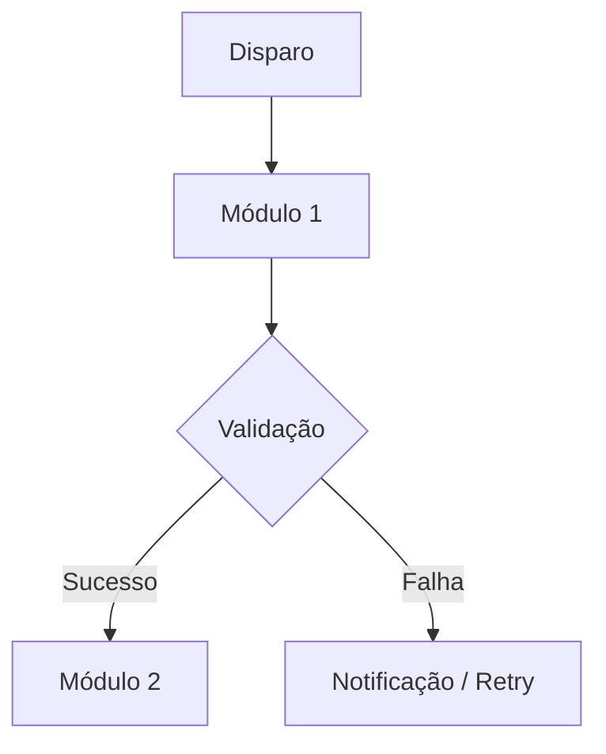

# 🔀 {{NOME_DO_FLUXO}}

## 🎯 Objetivo do Fluxo

O que este fluxo operacional ou de dados realiza de ponta a ponta e qual valor entrega ao negócio.

## 👥 Atores e Componentes Envolvidos

- **Disparador:** Agendador automático (APScheduler) | Ação manual do usuário via Dashboard | Evento do SO
- **Módulos participantes:** [[modulo_1]], [[modulo_2]]
- **Integrações acionadas:** [[integracao_x]], [[integracao_y]]
- **Destinatários:** Equipe Financeira, Servidor de Rede, Portal Corporativo

## 🔄 Diagrama de Sequência / Fluxo

## 📋 Passo a Passo Operacional

1. **Gatilho / Início:** Como e quando se inicia.
2. **Coleta / Extração:** Onde busca as informações.
3. **Transformação / Processamento:** Tratamento, parsing, cruzamento de regras.
4. **Carga / Armazenamento:** Gravação em rede local, banco de dados ou upload.
5. **Auditoria / Notificação:** Registro de logs e envio de e-mails de confirmação.

## ⚠️ Pontos Críticos e Gargalos

- Etapas sujeitas a indisponibilidade ou latência.

## 🔎 Evidências no Código

- Scripts orquestradores e arquivos de configuração relacionados.
